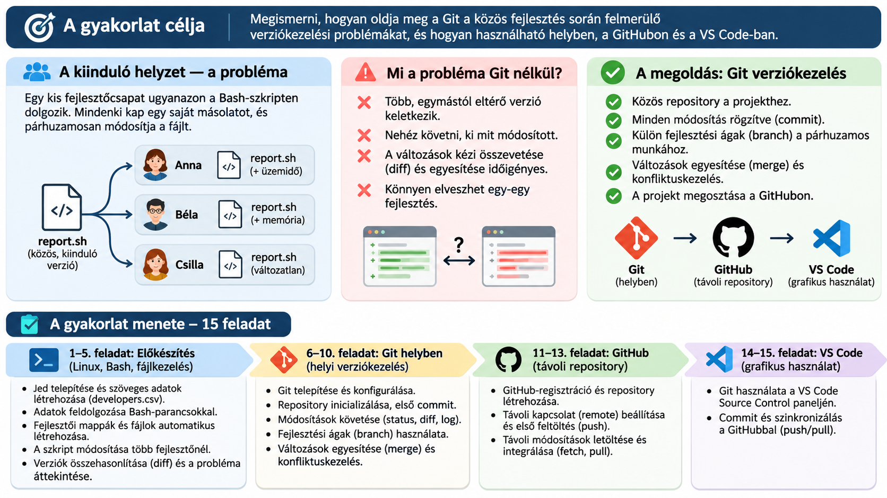

::: {.callout-important}
## Munkakörnyezet és határidő
A gyakorlat a korábbi héten létrehozott **Debian VM-en** zajlik, PowerShellből vagy VS Code Remote – SSH kapcsolattal. **Beadási határidő: 2026. november 12., csütörtök, 11:40 (magyar idő).** Az 1–10. feladatban a parancsokat önállóan hajtsd végre; a 11–15. feladatban dokumentáció és AI használható. **Jelszót, hozzáférési tokent és privát kulcsot ne illessz be a válaszmezőkbe.**
:::

**Neptun-kód (kötelező, 6 karakter):** <input id="neptun" data-answer="STUDENT_ID" maxlength="6" pattern="[A-Za-z0-9]{6}" required placeholder="ABC123" />

## A probléma: három fejlesztő, három különböző fájl

{fig-align="center" width="100%"}

**Projektforgatókönyv.** Anna, Béla és Csilla ugyanannak a `report.sh` Bash-szkriptnek a másolatával indul. Anna az üzemidőt, Béla a memóriaadatokat bővíti, majd mindketten ugyanazt a fejlécsort is átírják. Melyik változat a legfrissebb? Hogyan őrizhető meg mindkét fejlesztés? Először a `diff` segítségével vizsgálod meg a problémát, utána Gittel oldod meg.

::: {.callout-note}
## Tervezett projektstruktúra
```text
team-project/
├── developers.csv
├── setup.sh
├── project/
│   └── report.sh          # közös kiinduló változat
└── developers/
    ├── anna/report.sh
    ├── bela/report.sh
    └── csilla/report.sh
```
A 6–15. feladatban **csak a `project/` könyvtárat** tesszük Git-repositoryvá. A fejlesztői másolatok a manuális verziókezelés szemléltetésére maradnak meg.
:::


## I. A Git nélküli fejlesztés problémája (1–5. feladat)

### 1. feladat – SSH-kapcsolat és Jed telepítése

**Környezet:** PowerShell vagy VS Code terminál → Debian VM · **AI:** nem használható.

Csatlakozz a Debian VM-hez, ellenőrizd a felhasználót és a munkakönyvtárat, majd telepítsd a Jed szövegszerkesztőt. Hozd létre a `~/team-project/project` könyvtárat.
```bash
ssh azureuser@PUBLIC_IP
whoami
pwd
sudo apt update
sudo apt install -y jed
mkdir -p ~/team-project/project
cd ~/team-project
jed --version
```
A `PUBLIC_IP` helyére a saját VM-címedet írd. Ha a `jed --version` nem támogatott a telepített változatban, ellenőrizd a `command -v jed` paranccsal.

<div class="lab-answer"><label for="q01result"><strong>A végrehajtott parancsok, kimenetek és rövid magyarázat:</strong></label><textarea id="q01result" data-answer="Q01_RESULT" rows="5" placeholder="Parancsok, eredmények, rövid magyarázat..."></textarea><button type="button" class="btn btn-outline-primary btn-sm lab-check" data-check="ssh">Formai ellenőrzés</button><span class="lab-feedback" role="status" aria-live="polite"></span></div>
**Elfogadási feltétel:** A Jed elérhető, és a projektkönyvtár létrejött.


### 2. feladat – Fejlesztői adatok és szövegfeldolgozás

**Környezet:** Debian, Jed és shell · **AI:** nem használható.

Hozd létre Jedben a `developers.csv` fájlt. Az állomány **pontosvesszővel tagolt** (nem vesszővel):
```text
id;name;username;role;hours
1;Anna Kovacs;anna;backend;32
2;Bela Nagy;bela;frontend;24
3;Csilla Toth;csilla;tester;20
```
Listázd a felhasználóneveket, számold meg a fejlesztőket és add össze a munkaórákat.
```bash
jed developers.csv
cut -d';' -f3 developers.csv
tail -n +2 developers.csv | wc -l
awk -F';' 'NR>1 {sum+=$5} END {print sum}' developers.csv
```
**Elvárt összeg: 76 óra.**

<div class="lab-answer"><label for="q02result"><strong>A végrehajtott parancsok, kimenetek és rövid magyarázat:</strong></label><textarea id="q02result" data-answer="Q02_RESULT" rows="5" placeholder="Parancsok, eredmények, rövid magyarázat..."></textarea><button type="button" class="btn btn-outline-primary btn-sm lab-check" data-check="csv">Formai ellenőrzés</button><span class="lab-feedback" role="status" aria-live="polite"></span></div>
**Elfogadási feltétel:** A három fejlesztő és a 76 munkaóra ellenőrizhető.


### 3. feladat – Közös program és fejlesztői munkapéldányok

**Környezet:** Debian, Bash · **AI:** nem használható.

Készítsd el Jedben a `project/report.sh` fájlt:
```bash
#!/bin/bash
echo "PROJECT STATUS REPORT"
echo "Hostname: $(hostname)"
echo "User: $(whoami)"
echo "Date: $(date '+%Y-%m-%d')"
```
Hozz létre egy `setup.sh` szkriptet, amely a `developers.csv` fájlból olvassa a neveket, minden fejlesztőnek könyvtárat készít, és bemásolja a közös programot. Kiinduló ciklus:
```bash
#!/bin/bash
set -e
cd "$(dirname "$0")"
while IFS=';' read -r id name username role hours; do
  mkdir -p "developers/$username"
  cp project/report.sh "developers/$username/report.sh"
done < <(tail -n +2 developers.csv)
```
Ellenőrizd a szintaxist és a másolatokat:
```bash
bash -n setup.sh
bash setup.sh
find developers -type f -name 'report.sh'
```
**Figyelem:** a `setup.sh` újrafuttatása felülírja a fejlesztői példányokat! A 4–5. feladatban ne futtasd újra.

<div class="lab-answer"><label for="q03result"><strong>A végrehajtott parancsok, kimenetek és rövid magyarázat:</strong></label><textarea id="q03result" data-answer="Q03_RESULT" rows="5" placeholder="Parancsok, eredmények, rövid magyarázat..."></textarea><button type="button" class="btn btn-outline-primary btn-sm lab-check" data-check="bash">Formai ellenőrzés</button><span class="lab-feedback" role="status" aria-live="polite"></span></div>
**Elfogadási feltétel:** Három különálló, azonos tartalmú másolat készült.


### 4. feladat – Párhuzamos módosítások Git nélkül

**Környezet:** Debian, Jed · **AI:** nem használható.

Anna saját `developers/anna/report.sh` fájljának végére írja:
```bash
echo "Uptime: $(uptime -p)"
```
Béla saját `developers/bela/report.sh` fájljának végére írja:
```bash
echo "Memory:"
free -h
```
Csilla nem változtat. Futtasd mindhárom változatot, és ellenőrizd, hogy a `project/report.sh` érintetlen maradt. Ezután Anna és Béla **ugyanazt a fejlécsort** is módosítsa, de eltérő szövegre (`ANNA STATUS REPORT`, illetve `BELA STATUS REPORT`).

<div class="lab-answer"><label for="q04result"><strong>A végrehajtott parancsok, kimenetek és rövid magyarázat:</strong></label><textarea id="q04result" data-answer="Q04_RESULT" rows="5" placeholder="Parancsok, eredmények, rövid magyarázat..."></textarea><button type="button" class="btn btn-outline-primary btn-sm lab-check" data-check="bash">Formai ellenőrzés</button><span class="lab-feedback" role="status" aria-live="polite"></span></div>
**Elfogadási feltétel:** Anna és Béla változata eltér a közös programtól, Csilláé azonos.


### 5. feladat – Különbségek és manuális integrációs probléma

**Környezet:** Debian, diff · **AI:** nem használható.

Hasonlítsd össze a közös változatot mindhárom fejlesztő fájljával, majd Anna és Béla fájlját egymással:
```bash
diff -u project/report.sh developers/anna/report.sh
diff -u project/report.sh developers/bela/report.sh
diff -u project/report.sh developers/csilla/report.sh
diff -u developers/anna/report.sh developers/bela/report.sh
```
A `diff` **1-es kilépési kódja eltérést jelent, nem feltétlenül hibát**. Írd le, mely változtatások integrálhatók könnyen, és hol jelentkezik ütközés. **Ne írd felül a közös fájlt**: a megoldást a Git-feladatokban készíted el.

<div class="lab-answer"><label for="q05result"><strong>A végrehajtott parancsok, kimenetek és rövid magyarázat:</strong></label><textarea id="q05result" data-answer="Q05_RESULT" rows="5" placeholder="Parancsok, eredmények, rövid magyarázat..."></textarea><button type="button" class="btn btn-outline-primary btn-sm lab-check" data-check="diff">Formai ellenőrzés</button><span class="lab-feedback" role="status" aria-live="polite"></span></div>
**Elfogadási feltétel:** A három összehasonlítás eredménye és az ütköző fejléc magyarázata szerepel.


## II. Helyi Git-verziókövetés (6–10. feladat)

### 6. feladat – Git telepítése és konfigurálása

**Környezet:** Debian, Git · **AI:** nem használható.

Ellenőrizd vagy telepítsd a Gitet, majd állítsd be a saját commit-nevedet és e-mail-címedet. Az e-mail-cím lehet a GitHub-fiókodhoz tartozó no-reply cím is.
```bash
git --version
sudo apt install -y git
git config --global user.name "Sajat Nev"
git config --global user.email "email@example.com"
git config --global --list
```
**Ne írj valódi jelszót a Git-konfigurációba.**

<div class="lab-answer"><label for="q06result"><strong>A végrehajtott parancsok, kimenetek és rövid magyarázat:</strong></label><textarea id="q06result" data-answer="Q06_RESULT" rows="5" placeholder="Parancsok, eredmények, rövid magyarázat..."></textarea><button type="button" class="btn btn-outline-primary btn-sm lab-check" data-check="git">Formai ellenőrzés</button><span class="lab-feedback" role="status" aria-live="polite"></span></div>
**Elfogadási feltétel:** A Git működik, és a szerzői adatok be vannak állítva.


### 7. feladat – Helyi repository és első commit

**Környezet:** Debian, Git · **AI:** nem használható.

Lépj be **kizárólag** a `~/team-project/project` könyvtárba, inicializálj Git-repositoryt, majd rögzítsd a közös `report.sh` kiinduló változatát.
```bash
cd ~/team-project/project
git init -b main
git status
git add report.sh
git commit -m "Initial shared report"
git log --oneline
```
A `developers/` mappák a repositoryn kívül maradnak.

<div class="lab-answer"><label for="q07result"><strong>A végrehajtott parancsok, kimenetek és rövid magyarázat:</strong></label><textarea id="q07result" data-answer="Q07_RESULT" rows="5" placeholder="Parancsok, eredmények, rövid magyarázat..."></textarea><button type="button" class="btn btn-outline-primary btn-sm lab-check" data-check="git">Formai ellenőrzés</button><span class="lab-feedback" role="status" aria-live="polite"></span></div>
**Elfogadási feltétel:** Létezik az első commit a main ágon.


### 8. feladat – Változtatások és commitok követése

**Környezet:** Debian, Git · **AI:** nem használható.

Bővítsd a közös `report.sh` programot az üzemidő kiírásával (Anna ötlete), majd vizsgáld meg a módosítást és készíts commitot.
```bash
git status
git diff
git add report.sh
git diff --staged
git commit -m "Add uptime to report"
git log --oneline
```
Magyarázd meg a munkakönyvtár, staging area és repository közti különbséget.

<div class="lab-answer"><label for="q08result"><strong>A végrehajtott parancsok, kimenetek és rövid magyarázat:</strong></label><textarea id="q08result" data-answer="Q08_RESULT" rows="5" placeholder="Parancsok, eredmények, rövid magyarázat..."></textarea><button type="button" class="btn btn-outline-primary btn-sm lab-check" data-check="git">Formai ellenőrzés</button><span class="lab-feedback" role="status" aria-live="polite"></span></div>
**Elfogadási feltétel:** Az új commit és a staged/unstaged állapotok dokumentáltak.


### 9. feladat – Fejlesztési ág létrehozása

**Környezet:** Debian, Git · **AI:** nem használható.

Hozz létre `feature/memory` ágat, és Béla ötlete alapján add hozzá a memóriahasználatot. Commitold a változást, majd válts vissza a main ágra.
```bash
git switch -c feature/memory
# szerkeszd a report.sh fájlt
git add report.sh
git commit -m "Add memory information"
git switch main
git branch -v
```
Ellenőrizd, hogy a `main` és a `feature/memory` eltérő állapotot mutat.

<div class="lab-answer"><label for="q09result"><strong>A végrehajtott parancsok, kimenetek és rövid magyarázat:</strong></label><textarea id="q09result" data-answer="Q09_RESULT" rows="5" placeholder="Parancsok, eredmények, rövid magyarázat..."></textarea><button type="button" class="btn btn-outline-primary btn-sm lab-check" data-check="git">Formai ellenőrzés</button><span class="lab-feedback" role="status" aria-live="polite"></span></div>
**Elfogadási feltétel:** A feature ág commitja elkülönül a main ágtól.


### 10. feladat – Merge és valódi konfliktus

**Környezet:** Debian, Git · **AI:** nem használható.

Először egyesítsd Béla fejlesztését:
```bash
git merge feature/memory
git log --oneline --graph --all
```
**Konfliktusdemó külön ágon:** a tiszta `main` állapotából hozz létre `feature/title` ágat, írd át a fejlécet `ANNA STATUS REPORT` szövegre és commitold. Válts vissza `main`-re, írd át **ugyanazt a sort** `BELA STATUS REPORT` szövegre, és ezt is commitold. Ezután próbáld meg a `git merge feature/title` parancsot. Nézd meg a `<<<<<<<`, `=======`, `>>>>>>>` jelöléseket; szerkeszd a fájlt egységes fejlécűre, majd `git add report.sh` és `git commit` segítségével zárd le a merge-et. Végül ellenőrizd: `bash -n report.sh`.

<div class="lab-answer"><label for="q10result"><strong>A végrehajtott parancsok, kimenetek és rövid magyarázat:</strong></label><textarea id="q10result" data-answer="Q10_RESULT" rows="5" placeholder="Parancsok, eredmények, rövid magyarázat..."></textarea><button type="button" class="btn btn-outline-primary btn-sm lab-check" data-check="git">Formai ellenőrzés</button><span class="lab-feedback" role="status" aria-live="polite"></span></div>
**Elfogadási feltétel:** A konfliktus és a feloldás dokumentált, a szkript szintaktikailag helyes.


## III. GitHub és távoli repository (11–13. feladat)

### 11. feladat – GitHub-fiók és üres repository

**Környezet:** GitHub web, Debian · **AI:** használható.

Jelentkezz be a GitHubra (szükség esetén regisztrálj). Hozz létre **üres privát** repositoryt `linux-monitor-<azonosito>` néven, README és `.gitignore` automatikus létrehozása nélkül. Ellenőrizd a `gh` CLI telepítését; ha hiányzik, használd a GitHub hivatalos Debian telepítési útmutatóját. Hitelesítés:
```bash
gh --version
gh auth login
gh auth status
```
A CLI-ben **GitHub.com → HTTPS → Authenticate Git with your GitHub credentials: Yes → Login with a web browser** beállításokat válaszd. A böngészős kódot a saját gépeden add meg. **Tokeneket ne másolj a beadásba.**

<div class="lab-answer"><label for="q11result"><strong>A végrehajtott parancsok, kimenetek és rövid magyarázat:</strong></label><textarea id="q11result" data-answer="Q11_RESULT" rows="5" placeholder="Parancsok, eredmények, rövid magyarázat..."></textarea><button type="button" class="btn btn-outline-primary btn-sm lab-check" data-check="github">Formai ellenőrzés</button><span class="lab-feedback" role="status" aria-live="polite"></span></div>
**Elfogadási feltétel:** Létezik az üres GitHub-repository, a CLI hitelesített.


### 12. feladat – Remote és első push

**Környezet:** Debian, GitHub · **AI:** használható.

A helyi `project` repositoryban add hozzá a távoli URL-t (a saját URL-edet használd), és töltsd fel a `main` ágat:
```bash
cd ~/team-project/project
git remote add origin https://github.com/FELHASZNALO/REPOSITORY.git
git remote -v
git push -u origin main
```
Ha már van `origin`, ellenőrizd az URL-t; ne adj hozzá másodszor azonos nevű remote-ot. A GitHub webes felületén ellenőrizd a commitokat.

<div class="lab-answer"><label for="q12result"><strong>A végrehajtott parancsok, kimenetek és rövid magyarázat:</strong></label><textarea id="q12result" data-answer="Q12_RESULT" rows="5" placeholder="Parancsok, eredmények, rövid magyarázat..."></textarea><button type="button" class="btn btn-outline-primary btn-sm lab-check" data-check="git">Formai ellenőrzés</button><span class="lab-feedback" role="status" aria-live="polite"></span></div>
**Elfogadási feltétel:** A main ág és a report.sh megjelent a GitHubon.


### 13. feladat – Fetch és pull különbsége

**Környezet:** GitHub web és Debian · **AI:** használható.

A GitHub webes felületén módosítsd a `report.sh` egyik **nem konfliktusos** megjegyzését, és commitold. Ezután:
```bash
git fetch origin
git log --oneline main..origin/main
git diff main origin/main
git pull --ff-only
```
Ellenőrizd, hogy a `fetch` után a munkafájl változatlan, a `pull` után pedig frissült. A feladatot tiszta munkakönyvtárból indítsd.

<div class="lab-answer"><label for="q13result"><strong>A végrehajtott parancsok, kimenetek és rövid magyarázat:</strong></label><textarea id="q13result" data-answer="Q13_RESULT" rows="5" placeholder="Parancsok, eredmények, rövid magyarázat..."></textarea><button type="button" class="btn btn-outline-primary btn-sm lab-check" data-check="git">Formai ellenőrzés</button><span class="lab-feedback" role="status" aria-live="polite"></span></div>
**Elfogadási feltétel:** A fetch és pull különbségét konkrét eredménnyel magyarázza.


## IV. VS Code grafikus Git-kezelés (14–15. feladat)

### 14. feladat – VS Code Source Control – grafikus commit

**Környezet:** Windows VS Code Remote – SSH · **AI:** használható.

Telepítsd/használd a **Remote – SSH** bővítményt, és nyisd meg a Debian VM `~/team-project/project` mappáját VS Code-ban. A **Source Control** panelen módosítsd a `report.sh` egyik kommentjét, nézd meg a diffet, majd grafikus felületen végezz **Stage Changes** és **Commit** műveleteket. A GitHub-böngésző itt még nem szükséges.

<div class="lab-answer"><label for="q14result"><strong>A végrehajtott parancsok, kimenetek és rövid magyarázat:</strong></label><textarea id="q14result" data-answer="Q14_RESULT" rows="5" placeholder="Parancsok, eredmények, rövid magyarázat..."></textarea><button type="button" class="btn btn-outline-primary btn-sm lab-check" data-check="vscode">Formai ellenőrzés</button><span class="lab-feedback" role="status" aria-live="polite"></span></div>
**Elfogadási feltétel:** A Source Control panel és a létrejött commit dokumentált.


### 15. feladat – VS Code Push/Pull és zárás

**Környezet:** Windows VS Code, GitHub, Azure Portal · **AI:** használható.

A VS Code Source Control felületén végezd el a **Push** vagy **Sync Changes** műveletet. Ellenőrizd a GitHubon, hogy a 14. feladat commitja megjelent. Írd le a `push`, `fetch` és `pull` különbségét egy-egy mondatban. Végül az Azure Portalon **állítsd le és deallokáld** a VM-et; ellenőrizd a `Stopped (deallocated)` állapotot. A helyi és távoli repository szinkronizáltságát is dokumentáld.

<div class="lab-answer"><label for="q15result"><strong>A végrehajtott parancsok, kimenetek és rövid magyarázat:</strong></label><textarea id="q15result" data-answer="Q15_RESULT" rows="5" placeholder="Parancsok, eredmények, rövid magyarázat..."></textarea><button type="button" class="btn btn-outline-primary btn-sm lab-check" data-check="vscode">Formai ellenőrzés</button><span class="lab-feedback" role="status" aria-live="polite"></span></div>
**Elfogadási feltétel:** A GitHubon megjelent a commit, és a VM deallokált állapotú.


---

```{=html}
<style>
.lab-answer {display:flex;flex-direction:column;gap:.45rem;margin:1rem 0 1.5rem}
.lab-answer input,.lab-answer textarea {width:100%;max-width:100%;padding:.65rem;border:1px solid #9ca3af;border-radius:5px;font:inherit}
.lab-answer textarea {min-height:6rem;resize:vertical}
.lab-answer button {align-self:flex-start}
.lab-feedback.ok {color:#176b36}.lab-feedback.warn {color:#a45c00}
</style>
```

## Mentés és beadás

A válaszok automatikusan mentődnek ebben a böngészőben. A beadás előtt ellenőrizd a Neptun-kódot és a kitöltött mezőket. A szintaktikai ellenőrzés nem helyettesíti a parancsok tényleges futtatását.

<div class="actions">
<button id="submit-button" type="button" onclick="openSubmissionSummary()">📤 Beadás</button>
<button type="button" onclick="exportSubmissionJson()">💾 JSON export</button>
<button type="button" onclick="clearAnswers()">Helyi adatok törlése</button>
<span id="save-status" role="status"></span>
</div>
<p id="submission-deadline-note"><strong>Beadási határidő:</strong> 2026. november 12. 11:40 (magyar idő).</p>
<div id="submission-summary" class="submission-summary" hidden>
<h3>Beadás előtti összesítés</h3>
<div id="submission-summary-body"></div>
<div class="actions"><button type="button" onclick="closeSubmissionSummary()">Vissza a javításhoz</button><button id="confirm-submit-button" type="button" onclick="confirmSubmission()">Beadás megerősítése</button></div>
</div>
<div id="submission-result" role="status" aria-live="polite"></div>

::: {.callout-note title="Aktivitási adatok"}
Az időmérés és az eseménykövetés a projekt `config/setup.js` fájljából konfigurálható. Az SSH-terminálban végzett munka nem feltétlenül számít böngészőbeli aktív időnek.
:::
<div id="tracking-panel" class="submission-summary">
<strong>Aktivitás ezen a gépen</strong>
<p>Időmérés: <span id="tracking-time-status">–</span> · Eseménykövetés: <span id="tracking-event-status">–</span></p>
<p>Becsült aktív idő: <span id="activity-active-time">0:00</span> · Szerkesztések: <span id="activity-edit-count">0</span></p>
<p>Első megnyitás: <span id="activity-started">–</span> · Utolsó aktivitás: <span id="activity-last">–</span></p>
</div>

<style>
.actions {display:flex;flex-wrap:wrap;gap:.65rem;align-items:center;margin:1rem 0}
.actions button {padding:.55rem .9rem;border:1px solid #77808a;border-radius:6px;background:#fff;cursor:pointer}
.actions button:disabled {opacity:.5;cursor:not-allowed}
.submission-summary {border:1px solid #c8d0d8;border-radius:9px;padding:1rem;margin:1rem 0;background:#fafbfc}
.submission-summary[hidden] {display:none}
#submission-result {margin:1rem 0}
</style>
<script src="../../config/setup.js"></script>
<script>
(function(){
  const patterns={
    ssh:/\b(ssh|whoami|hostname|pwd)\b/i, csv:/[;]|\b(cut|awk|grep|tail)\b/i,
    bash:/\b(while|for|read|mkdir|cp|bash|chmod|jed)\b/i,
    diff:/\bdiff\b|---|\+\+\+/i,
    git:/\bgit\s+(init|status|add|commit|log|diff|branch|switch|merge|remote|push|fetch|pull|config)\b/i,
    github:/github\.com|gh auth|https/i,
    vscode:/Source Control|Remote.SSH|VS Code|stage|commit|sync/i
  };
  document.addEventListener('click',e=>{
    const b=e.target.closest('.lab-check'); if(!b)return;
    const wrap=b.closest('.lab-answer'), field=wrap?.querySelector('input,textarea');
    const feedback=wrap?.querySelector('.lab-feedback'); if(!field||!feedback)return;
    const v=field.value.trim(),p=patterns[b.dataset.check]||/\S{12}/;
    const ok=v.length>=8&&p.test(v);
    feedback.textContent=ok?'A válasz formailag megfelelőnek tűnik. A tényleges végrehajtást ez nem igazolja.':'Egészítsd ki konkrét parancsokkal, kimenettel vagy a kért magyarázattal.';
    feedback.className='lab-feedback '+(ok?'ok':'warn');
  });
})();
</script>
```

<script>
(() => {
  'use strict';
  const CONFIG = Object.assign({timeTracking:false,eventTracking:false,showTrackingPanel:false},window.ITARCH_SETUP||{});
  const STORAGE_KEY = 'itarch_week07_answers_2026';
  // OKTATÓI BEÁLLÍTÁS: a végleges határidőt itt add meg ISO 8601 formában,
  // pl. '2026-10-29T11:40:00+01:00'. A null azt jelenti, hogy nincs korlátozás.
  const SUBMISSION_DEADLINE_ISO = '2026-11-12T11:40:00+01:00';
  const ENDPOINT = 'https://itarch-backend-fpdsf6brfpanf5d8.northeurope-01.azurewebsites.net/api/submit';
  const $ = id => document.getElementById(id);
  const fields = () => [...document.querySelectorAll('[data-answer]')];
  const studentId = () => ($('neptun')?.value||'').trim().toUpperCase();
  const validId = () => /^[A-Z0-9]{6}$/.test(studentId());
  const nowIso = () => new Date().toISOString();
  const deadline = SUBMISSION_DEADLINE_ISO ? new Date(SUBMISSION_DEADLINE_ISO) : null;
  const closed = () => deadline && !isNaN(deadline.getTime()) && Date.now() > deadline.getTime();
  const started = nowIso();
  let activity = {started_at:started,last_activity_at:started,active_seconds_estimate:0,edit_count:0,events:[]};
  let lastInteraction = Date.now();
  const esc = v => String(v??'').replace(/[&<>"']/g,c=>({'&':'&amp;','<':'&lt;','>':'&gt;','"':'&quot;',"'":'&#39;'}[c]));
  const logEvent = (type) => {if(CONFIG.eventTracking) activity.events.push({type,at:nowIso()});};
  const answers = () => Object.fromEntries(fields().filter(f=>f.dataset.answer!=='STUDENT_ID').map(f=>[f.dataset.answer,f.value]));
  const save = (message=false) => {
    activity.last_activity_at=nowIso();
    try {localStorage.setItem(STORAGE_KEY,JSON.stringify({student_id:studentId(),answers:answers(),activity}));
      if(message) $('save-status').textContent='✓ Helyi mentés kész';
    } catch(e) {if(message) $('save-status').textContent='⚠ Helyi mentés nem érhető el';}
  };
  const load = () => {
    try {const stored=JSON.parse(localStorage.getItem(STORAGE_KEY)||'null'); if(!stored)return;
      if(stored.student_id) $('neptun').value=stored.student_id;
      fields().forEach(f=>{if(f.dataset.answer!=='STUDENT_ID' && Object.hasOwn(stored.answers||{},f.dataset.answer))f.value=stored.answers[f.dataset.answer]});
      if(stored.activity)activity=Object.assign(activity,stored.activity);
    }catch(e){}
  };
  const renderActivity = () => {
    $('tracking-panel').hidden=!CONFIG.showTrackingPanel;
    $('tracking-time-status').textContent=CONFIG.timeTracking?'bekapcsolva':'kikapcsolva';
    $('tracking-event-status').textContent=CONFIG.eventTracking?'bekapcsolva':'kikapcsolva';
    const sec=activity.active_seconds_estimate||0;
    $('activity-active-time').textContent=`${Math.floor(sec/60)}:${String(sec%60).padStart(2,'0')}`;
    $('activity-edit-count').textContent=activity.edit_count||0;
    $('activity-started').textContent=activity.started_at||'–';
    $('activity-last').textContent=activity.last_activity_at||'–';
  };
  const refreshDeadline = () => {
    const isClosed=closed();
    $('submit-button').hidden=!!isClosed;
    if($('confirm-submit-button'))$('confirm-submit-button').disabled=!!isClosed||!validId();
    $('submission-deadline-note').textContent=deadline && !isNaN(deadline.getTime())
      ? `Beadási határidő: ${deadline.toLocaleString('hu-HU',{timeZone:'Europe/Budapest'})} (magyar idő)${isClosed?' – lejárt':''}`
      : 'Beadási határidő: még nincs beállítva a munkafüzetben.';
  };
  const payload = () => ({schema_version:1,course:'ITARCH',week:7,student_id:studentId(),submitted_at:nowIso(),answers:answers(),checks:{},activity_summary:activity});
  window.openSubmissionSummary = () => {
    refreshDeadline();if(closed())return;
    const fs=fields().filter(f=>f.dataset.answer!=='STUDENT_ID');
    const missing=fs.filter(f=>!f.value.trim());
    const groups=[...new Set(missing.map(f=>(f.dataset.answer.match(/^Q(\d\d)/)||[])[1]).filter(Boolean))];
    const complete=fs.length-missing.length;
    $('submission-summary-body').innerHTML=`<p><strong>Neptun:</strong> ${esc(studentId()||'nincs megadva')} ${validId()?'✓':'⚠ 6 betű/szám szükséges'}</p>
      <p><strong>Kitöltött mezők:</strong> ${complete}/${fs.length} (${Math.round(100*complete/Math.max(1,fs.length))}%)</p>
      <p><strong>Hiányos feladatok:</strong> ${groups.length?groups.map(x=>Number(x)).join(', '):'nincs'}</p>
      ${missing.length?`<p>Összesen ${missing.length} mező üres. A beadás ettől még lehetséges, de ellenőrizd a válaszokat.</p>`:''}
      <p>A szintaktikai ellenőrző gombok használata nem kötelező. Biztosan beadod?</p>`;
    $('submission-summary').hidden=false;
    $('submission-summary').scrollIntoView({behavior:'smooth',block:'start'});
    logEvent('submission_summary_opened');save();refreshDeadline();
  };
  window.closeSubmissionSummary=()=>{$('submission-summary').hidden=true;};
  const download = data => {
    const file=`ITARCH_week07_${data.student_id}_${data.submitted_at.replace(/[:.]/g,'-')}.json`;
    const blob=new Blob([JSON.stringify(data,null,2)],{type:'application/json;charset=utf-8'});
    const url=URL.createObjectURL(blob),a=document.createElement('a');a.href=url;a.download=file;document.body.append(a);a.click();a.remove();setTimeout(()=>URL.revokeObjectURL(url),1000);
  };
  window.exportSubmissionJson=()=>{if(!validId()){$('submission-result').textContent='⚠ A JSON exporthoz 6 karakteres Neptun-kód szükséges.';return;}logEvent('submission_json_exported');save();download(payload());};
  window.confirmSubmission=async()=>{
    if(closed()){$('submission-result').textContent='⚠ A beadási határidő lejárt.';refreshDeadline();return;}
    if(!validId()){$('submission-result').textContent='⚠ Adj meg érvényes, 6 karakteres Neptun-kódot.';return;}
    const btn=$('confirm-submit-button');btn.disabled=true;
    $('submission-result').textContent='Beadás folyamatban…';
    try {
      const response=await fetch(ENDPOINT,{method:'POST',headers:{'Content-Type':'application/json'},body:JSON.stringify(payload())});
      const result=await response.json().catch(()=>null);
      if(!response.ok||!result||result.success!==true)throw new Error(`HTTP ${response.status}`);
      logEvent('submission_succeeded');save();$('submission-summary').hidden=true;
      $('submission-result').textContent=`✓ Beadás sikeres. Azonosító: ${result.submission_id||'–'}`;
    }catch(e){logEvent('submission_failed');save();$('submission-result').textContent='⚠ A szerveres beadás nem sikerült. A helyi mentés megmaradt; próbáld újra, vagy készíts JSON exportot.';}
    finally {btn.disabled=false;refreshDeadline();}
  };
  window.clearAnswers=()=>{
    if(!confirm('Biztosan törlöd az összes helyben mentett választ és aktivitási adatot?'))return;
    fields().forEach(f=>f.value='');
    try{localStorage.removeItem(STORAGE_KEY)}catch(e){}
    activity={started_at:nowIso(),last_activity_at:nowIso(),active_seconds_estimate:0,edit_count:0,events:[]};
    $('submission-summary').hidden=true;$('submission-result').textContent='';$('save-status').textContent='Helyi adatok törölve.';renderActivity();
  };
  document.addEventListener('DOMContentLoaded',()=>{
    load();refreshDeadline();renderActivity();
    fields().forEach(f=>{f.addEventListener('input',()=>{
      if(f.dataset.answer==='STUDENT_ID')f.value=f.value.toUpperCase().replace(/[^A-Z0-9]/g,'').slice(0,6);
      activity.edit_count++;lastInteraction=Date.now();logEvent('answer_edited');save();renderActivity();
    });f.addEventListener('change',()=>save());});
    document.addEventListener('keydown',()=>lastInteraction=Date.now());
    document.addEventListener('mousemove',()=>lastInteraction=Date.now(),{passive:true});
    document.addEventListener('visibilitychange',()=>save());
    window.addEventListener('beforeunload',()=>save());
    setInterval(()=>{if(CONFIG.timeTracking&&!document.hidden&&Date.now()-lastInteraction<120000){activity.active_seconds_estimate++;if(activity.active_seconds_estimate%10===0)save();renderActivity();}},1000);
    setInterval(refreshDeadline,30000);
  });
})();
</script>
