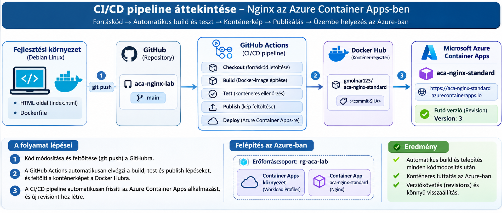

::: {.callout-important}
## Munkakörnyezet és beadás
**Órai idő: 90 perc.** A be nem fejezett feladatok otthon folytathatók. A munkafüzetben 15 egymásra épülő feladat található. A válaszmezők automatikusan mentődnek ebben a böngészőben; a lap alján **Beadás** és **JSON export** érhető el. Képernyőkép nem szükséges. **Jelszót, hozzáférési tokent, privát kulcsot és GitHub Secret-értéket soha ne másolj a válaszmezőkbe!** **Beadási határidő: 2026. november 26. (csütörtök), 11:40 (magyar idő).**
:::

**Neptun-kód (kötelező, 6 karakter):** <input id="neptun" data-answer="STUDENT_ID" maxlength="6" pattern="[A-Za-z0-9]{6}" required placeholder="ABC123" />

## A gyakorlat célja – egy működő CI/CD pipeline

{fig-alt="CI/CD folyamatábra: forráskód, automatikus build és teszt, konténerkép publikálása, Azure Container Apps telepítés" width="100%"}

**A feladat végére:** a Debian VM-en módosított `index.html` fájl `git push` után automatikusan új Docker-image-ként publikálódik, majd frissül az Azure Container Apps webalkalmazás. Az ábrán szereplő felhasználó- és erőforrásnevek **példák**: mindenki a saját GitHub- és Docker Hub-fiókját használja.

::: {.callout-note collapse="true"}
## CI és CD röviden
**CI (Continuous Integration):** a kódváltozás automatikus ellenőrzése, buildelése és tesztelése. **CD (Continuous Deployment):** a sikeres ellenőrzés után a működő alkalmazás automatikus frissítése. A gyakorlatban a GitHub Actions végzi a munkát; a Debian VM csak a fejlesztés helyszíne.
:::

## I. Projekt és helyi Docker-konténer

### 1. Előkészítés és azonosítók

**Platform:** Debian VM – SSH terminál; GitHub és Docker Hub böngésző.

Ellenőrizd a Git és Docker elérhetőségét. Hozz létre **új, üres** `aca-nginx-lab` nevű GitHub-repositoryt (README és licenc nélkül). Jegyezd fel a saját Docker Hub-felhasználónevedet.

```bash
git --version
docker --version
docker info --format '{{.ServerVersion}}'
```

::: {.callout-note collapse="true"}
## Ha a Docker socket hozzáférése tiltott
Ha `permission denied ... /var/run/docker.sock` jelenik meg, ellenőrzésként használd a `sudo docker info` parancsot. Tartós megoldásként a rendszergazda a felhasználót a `docker` csoportba veheti; a csoporttagság root-szintű jogosultsággal jár. Ne változtass jogosultságot ellenőrzés nélkül.
:::


<div class="lab-answer"><label for="q01result"><strong>Válasz – A GitHub-repository URL-je, Git/Docker verzió és Docker Hub-felhasználónév.</strong></label><textarea id="q01result" data-answer="Q01_RESULT" rows="6" placeholder="Parancsok, releváns kimenetek, URL-ek vagy rövid válasz..."></textarea><button type="button" class="btn btn-outline-primary btn-sm lab-check" data-check="task">Formai ellenőrzés</button><span class="lab-feedback" role="status" aria-live="polite"></span></div>

### 2. Nginx weboldal és Dockerfile

**Platform:** Debian VM – Bash, nano vagy jed.

Hozd létre a projektet, majd az alábbi két fájlt. A `Version: 1` feliratot később módosítjuk.

```bash
mkdir -p ~/aca-nginx-lab
cd ~/aca-nginx-lab
```

**`index.html`**

```html
<!doctype html>
<html lang="en"><head><meta charset="utf-8"><title>ACA Lab</title></head>
<body><h1>Azure Container Apps Lab</h1><p>Version: 1</p>
<p>Deployed from a Docker container.</p></body></html>
```

**`Dockerfile`**

```dockerfile
FROM nginx:alpine
COPY index.html /usr/share/nginx/html/index.html
EXPOSE 80
```

Ellenőrzés: `ls -l` és `cat Dockerfile`.

<div class="lab-answer"><label for="q02result"><strong>Válasz – A két fájl tartalma vagy a létrehozásukhoz használt parancsok.</strong></label><textarea id="q02result" data-answer="Q02_RESULT" rows="6" placeholder="Parancsok, releváns kimenetek, URL-ek vagy rövid válasz..."></textarea><button type="button" class="btn btn-outline-primary btn-sm lab-check" data-check="task">Formai ellenőrzés</button><span class="lab-feedback" role="status" aria-live="polite"></span></div>

### 3. Git inicializálása és első push

**Platform:** Debian VM – Git; GitHub webes felület.

Inicializáld a repositoryt, készíts első commitot, majd állítsd be a **saját** GitHub-repositorydat remote-ként.

```bash
cd ~/aca-nginx-lab
git init -b main
git add index.html Dockerfile
git commit -m "Initial Nginx app"
git remote add origin https://github.com/GITHUB_USER/aca-nginx-lab.git
git push -u origin main
```

A `GITHUB_USER` helyére saját GitHub-felhasználónevedet írd. Ellenőrizd a fájlokat a GitHub **Code** fülén.

::: {.callout-note collapse="true"}
## Ha a push nem sikerül
`Repository not found`: ellenőrizd, hogy a GitHubon létrejött-e a repository, és a `git remote -v` helyes URL-t mutat-e. `fetch first`: ha a távoli ágon új commit jelent meg, előbb `git pull --rebase origin main`, majd `git push origin main`. **Ne használj `--force` kapcsolót.**
:::


<div class="lab-answer"><label for="q03result"><strong>Válasz – A `git remote -v`, `git log --oneline` és a push lényegi eredménye.</strong></label><textarea id="q03result" data-answer="Q03_RESULT" rows="6" placeholder="Parancsok, releváns kimenetek, URL-ek vagy rövid válasz..."></textarea><button type="button" class="btn btn-outline-primary btn-sm lab-check" data-check="task">Formai ellenőrzés</button><span class="lab-feedback" role="status" aria-live="polite"></span></div>

### 4. Docker-image építése

**Platform:** Debian VM – Docker CLI.

Építsd fel a képet a saját Dockerfile-ból:

```bash
cd ~/aca-nginx-lab
docker build -t aca-nginx:v1 .
docker image ls aca-nginx
```

**Ellenőrzés:** szerepeljen az `aca-nginx` image `v1` taggel.

<div class="lab-answer"><label for="q04result"><strong>Válasz – A build parancsa és az image-lista releváns sora.</strong></label><textarea id="q04result" data-answer="Q04_RESULT" rows="6" placeholder="Parancsok, releváns kimenetek, URL-ek vagy rövid válasz..."></textarea><button type="button" class="btn btn-outline-primary btn-sm lab-check" data-check="task">Formai ellenőrzés</button><span class="lab-feedback" role="status" aria-live="polite"></span></div>

### 5. Helyi konténerteszt

**Platform:** Debian VM – Docker CLI, curl.

Indítsd el a konténert, majd ellenőrizd a HTTP-választ és az oldalt:

```bash
docker run -d --name aca-nginx-test -p 8080:80 aca-nginx:v1
curl -I http://localhost:8080
curl -s http://localhost:8080 | grep 'Version:'
docker ps --filter name=aca-nginx-test
```

Az ellenőrzés után állítsd le és töröld a tesztkonténert:

```bash
docker rm -f aca-nginx-test
```

::: {.callout-tip collapse="true"}
## Ha a 8080-as port foglalt
Válassz másik szabad **hostportot**, például `-p 8081:80`, és a `curl` parancsban is ezt használd. A konténeren belüli Nginx-port továbbra is `80`.
:::


<div class="lab-answer"><label for="q05result"><strong>Válasz – A `curl` HTTP-státusza, a Version-sor és a konténer állapota.</strong></label><textarea id="q05result" data-answer="Q05_RESULT" rows="6" placeholder="Parancsok, releváns kimenetek, URL-ek vagy rövid válasz..."></textarea><button type="button" class="btn btn-outline-primary btn-sm lab-check" data-check="task">Formai ellenőrzés</button><span class="lab-feedback" role="status" aria-live="polite"></span></div>

## II. Docker Hub és Azure Container Apps

### 6. Docker Hub image publikálása

**Platform:** Docker Hub webes felület; Debian VM – Docker CLI.

A Docker Hubon hozz létre egy **public** `aca-nginx-lab` repositoryt. A saját felhasználóneveddel taggeld és publikáld az image-et:

```bash
docker login --username DOCKERHUB_USER
docker tag aca-nginx:v1 DOCKERHUB_USER/aca-nginx-lab:v1
docker push DOCKERHUB_USER/aca-nginx-lab:v1
```

A jelszóbekérésnél Docker Hub **Personal Access Token** használható. A tokent **ne írd a parancsba vagy a munkafüzetbe**. A böngészőben ellenőrizd a `v1` taget.

::: {.callout-warning collapse="true"}
## Docker Hub token és jogosultság
A tokent a Docker Hub biztonsági beállításainál lehet létrehozni; a teljes érték csak létrehozáskor másolható ki. A GitHub Actionshez később külön token is használható. A tokent kizárólag jelszómezőbe vagy GitHub Secretbe írd.
:::


<div class="lab-answer"><label for="q06result"><strong>Válasz – A publikus image neve (`DOCKERHUB_USER/aca-nginx-lab:v1`) és a push eredménye.</strong></label><textarea id="q06result" data-answer="Q06_RESULT" rows="6" placeholder="Parancsok, releváns kimenetek, URL-ek vagy rövid válasz..."></textarea><button type="button" class="btn btn-outline-primary btn-sm lab-check" data-check="task">Formai ellenőrzés</button><span class="lab-feedback" role="status" aria-live="polite"></span></div>

### 7. Azure erőforráscsoport

**Platform:** Azure Portal – grafikus felület.

Az Azure Portalon válaszd az **Azure for Students** előfizetést, és hozz létre egy külön erőforráscsoportot, például `rg-aca-lab-ABC123` néven (a saját Neptun-kódoddal). Régió: **North Europe**. A későbbi összes erőforrást ebben a csoportban hozd létre.

::: {.callout-warning}
## Költségek
Az Azure for Students keret nem korlátlan. Ne hozz létre dedikált workload profilt, és a feladatok végén töröld a **csak ehhez a laborhoz használt** erőforráscsoportot.
:::


<div class="lab-answer"><label for="q07result"><strong>Válasz – Az előfizetés neve, az erőforráscsoport neve és a régió.</strong></label><textarea id="q07result" data-answer="Q07_RESULT" rows="6" placeholder="Parancsok, releváns kimenetek, URL-ek vagy rövid válasz..."></textarea><button type="button" class="btn btn-outline-primary btn-sm lab-check" data-check="task">Formai ellenőrzés</button><span class="lab-feedback" role="status" aria-live="polite"></span></div>

### 8. Workload Profiles környezet létrehozása

**Platform:** Azure Portal – grafikus felület.

A **Container Apps → Create** felületen hozz létre új Container Apps-környezetet (például `aca-lab-standard-ABC123`). A környezet beállításainál:

- **Workload Profiles / Tevékenységprofilok** típusú környezetet használj, ne Expresst.
- A beépített **Consumption** profil maradjon; **dedikált profilt ne adj hozzá**.
- Zónaredundancia: kikapcsolva; külön VNet nem szükséges.
- Monitorozás: `None`, ha elérhető.

**Ellenőrzés:** a Container Apps listában a környezet típusa **Tevékenységprofilok / Workload Profiles** legyen.

::: {.callout-tip collapse="true"}
## Alternatíva: környezet létrehozása kész Azure CLI-paranccsal
Ha a Portal ismét Express környezetet hoz létre, a következő **opcionális** parancsblokkot használhatod, ha az Azure CLI telepítve van és be vagy jelentkezve. A neveket cseréld a saját értékeidre:

```bash
az containerapp env create \
  --name aca-lab-standard-ABC123 \
  --resource-group rg-aca-lab-ABC123 \
  --location northeurope \
  --environment-mode WorkloadProfiles \
  --enable-workload-profiles true \
  --logs-destination none
```

A környezet típusát a Portalon ellenőrizd. Ez **nem** kötelező Azure CLI-feladat.
:::


<div class="lab-answer"><label for="q08result"><strong>Válasz – A környezet neve és a Portalban látható típusa.</strong></label><textarea id="q08result" data-answer="Q08_RESULT" rows="6" placeholder="Parancsok, releváns kimenetek, URL-ek vagy rövid válasz..."></textarea><button type="button" class="btn btn-outline-primary btn-sm lab-check" data-check="task">Formai ellenőrzés</button><span class="lab-feedback" role="status" aria-live="polite"></span></div>

### 9. Nginx Container App létrehozása

**Platform:** Azure Portal – Container Apps létrehozási varázsló.

Hozz létre új Container Appot a **8. feladat Workload Profiles környezetében**. Javasolt név: `aca-nginx-standard-ABC123`.

| Beállítás | Érték |
|---|---|
| Image | `docker.io/DOCKERHUB_USER/aca-nginx-lab:v1` |
| Workload profile | `Consumption` |
| CPU / memória | `0.25 vCPU` / `0.5 GiB` |
| Minimum / maximum replica | `0` / `1` |
| Bejövő forgalom (Ingress) | Engedélyezett, **külső**, HTTP |
| Célport (Target port) | `80` |

A Docker Hub-repository publikus, ezért az image lehúzásához nem kell registry-jelszó. **Ne keverd össze a konténer 80-as célportját a host gép 8080-as tesztportjával.**

<div class="lab-answer"><label for="q09result"><strong>Válasz – Az alkalmazás neve, az image pontos neve és az ingress-beállítások.</strong></label><textarea id="q09result" data-answer="Q09_RESULT" rows="6" placeholder="Parancsok, releváns kimenetek, URL-ek vagy rövid válasz..."></textarea><button type="button" class="btn btn-outline-primary btn-sm lab-check" data-check="task">Formai ellenőrzés</button><span class="lab-feedback" role="status" aria-live="polite"></span></div>

### 10. HTTPS URL és futó revision ellenőrzése

**Platform:** Azure Portal és böngésző.

Az alkalmazás **Áttekintés** oldalán nyisd meg az automatikusan kapott HTTPS URL-t. A weboldalon a `Version: 1` feliratot kell látnod. Nyisd meg az **Alkalmazás → Változatok és replikák** nézetet, és azonosítsd az aktív revisiont.

::: {.callout-note collapse="true"}
## Ha az oldal nem érhető el
Ellenőrizd, hogy a bejövő forgalom külső, a célport `80`, a container image neve és tagje helyes, valamint a revision fut-e. A skálázás miatt a `min replicas = 0` beállításnál az első kérés lassabb lehet.
:::


<div class="lab-answer"><label for="q10result"><strong>Válasz – A HTTPS URL, a megjelenő verzió és az aktív revision neve.</strong></label><textarea id="q10result" data-answer="Q10_RESULT" rows="6" placeholder="Parancsok, releváns kimenetek, URL-ek vagy rövid válasz..."></textarea><button type="button" class="btn btn-outline-primary btn-sm lab-check" data-check="task">Formai ellenőrzés</button><span class="lab-feedback" role="status" aria-live="polite"></span></div>

## III. GitHub Actions – automatizált CI/CD

### 11. GitHub Actions: build és teszt

**Platform:** GitHub – repository és Actions; Debian VM – Git.

A repositoryban hozd létre a `.github/workflows/ci.yml` fájlt. Az alábbi workflow minden `main` ágra történő push után felépíti az image-et, elindítja, majd ellenőrzi a weboldalt.

```yaml
name: Build and test Nginx
on:
  push:
    branches: [main]
  workflow_dispatch:
jobs:
  test:
    runs-on: ubuntu-latest
    steps:
      - uses: actions/checkout@v4
      - name: Build image
        run: docker build -t aca-nginx:ci .
      - name: Run and test
        run: |
          docker run -d --name web -p 8080:80 aca-nginx:ci
          for i in 1 2 3 4 5; do
            curl --fail http://localhost:8080 && exit 0
            sleep 2
          done
          exit 1
```

Commitold a fájlt, majd az **Actions** fülön ellenőrizd a futást. Ez még csak CI; a Docker Hub-publikálás és az Azure-deployment a következő feladatokban következik.

<div class="lab-answer"><label for="q11result"><strong>Válasz – A workflow neve, a commit azonosítója és a sikeres futás állapota.</strong></label><textarea id="q11result" data-answer="Q11_RESULT" rows="6" placeholder="Parancsok, releváns kimenetek, URL-ek vagy rövid válasz..."></textarea><button type="button" class="btn btn-outline-primary btn-sm lab-check" data-check="task">Formai ellenőrzés</button><span class="lab-feedback" role="status" aria-live="polite"></span></div>

### 12. Automatikus Docker Hub-publikálás

**Platform:** GitHub – Settings → Secrets and variables → Actions.

Hozz létre két repository secretet: `DOCKERHUB_USERNAME` és `DOCKERHUB_TOKEN`. A tokennek legyen megfelelő írási jogosultsága a saját repositoryhoz. A `ci.yml` workflow **test** jobjának végére illeszd a következő lépéseket (azonos behúzási szinten, mint a korábbi `- name` lépések):

```yaml
      - name: Docker Hub login
        uses: docker/login-action@v3
        with:
          username: ${{ secrets.DOCKERHUB_USERNAME }}
          password: ${{ secrets.DOCKERHUB_TOKEN }}
      - name: Build and push versioned image
        run: |
          docker build -t ${{ secrets.DOCKERHUB_USERNAME }}/aca-nginx-lab:${{ github.sha }} .
          docker push ${{ secrets.DOCKERHUB_USERNAME }}/aca-nginx-lab:${{ github.sha }}
```

Commit után ellenőrizd, hogy a Docker Hubon megjelent-e az új, **commit SHA-val címkézett** image.

::: {.callout-note collapse="true"}
## Miért használunk commit SHA-t tagként?
A SHA-val címkézett image egy konkrét forráskód-állapothoz kapcsolódik. Ez átláthatóbb, mint egy folyamatosan felülírt `latest` tag.
:::


<div class="lab-answer"><label for="q12result"><strong>Válasz – A GitHub Actions futás eredménye és a Docker Hub image-tag (token nélkül).</strong></label><textarea id="q12result" data-answer="Q12_RESULT" rows="6" placeholder="Parancsok, releváns kimenetek, URL-ek vagy rövid válasz..."></textarea><button type="button" class="btn btn-outline-primary btn-sm lab-check" data-check="task">Formai ellenőrzés</button><span class="lab-feedback" role="status" aria-live="polite"></span></div>

### 13. GitHub és Azure összekapcsolása

**Platform:** Azure Portal – Container App → Üzembe helyezés.

Nyisd meg a **9. feladatban létrehozott** Container Appot, majd az **Üzembe helyezés → Folyamatos üzembe helyezés** oldalt. Válaszd ki a saját GitHub-repositorydat és a `main` ágat. Registry: **Docker Hub vagy más registry**; add meg a saját image-nevet és a Docker Hub-hozzáférést. Azure-hozzáférésnél válaszd a **felhasználó által hozzárendelt identitást**, ha a Portal felajánlja. Indítsd el az integrációt.

A Portal létrehozhat egy **új GitHub Actions workflow-t** és hozzá kapcsolódó titkokat. Az új YAML-t a következő feladatban ellenőrizzük.

::: {.callout-warning collapse="true"}
## Ha a jogosultságok nem elegendők
Az Azure-integráció létrehozása managed identity, federált hitelesítés és szerepkör-hozzárendelés műveleteket igényelhet. Ha az egyetemi előfizetésben ezek tiltottak, **ne kérj vagy ossz meg rendszergazdai hitelesítő adatot**. Rögzítsd a hiba rövid leírását, és kérj oktatói segítséget.
:::


<div class="lab-answer"><label for="q13result"><strong>Válasz – A kapcsolt GitHub-repository/branch és a létrejött workflow fájlneve; a művelet eredménye.</strong></label><textarea id="q13result" data-answer="Q13_RESULT" rows="6" placeholder="Parancsok, releváns kimenetek, URL-ek vagy rövid válasz..."></textarea><button type="button" class="btn btn-outline-primary btn-sm lab-check" data-check="task">Formai ellenőrzés</button><span class="lab-feedback" role="status" aria-live="polite"></span></div>

### 14. Automatikus Azure-deployment és Version 2

**Platform:** GitHub Actions, Debian VM – Git; Azure Portal.

Az Azure által létrehozott workflow YAML-fájljában ellenőrizd a Dockerfile-alapú buildet és a helyes Container App-nevet. A működő deploy lépés lényege:

```yaml
      - name: Build and deploy container
        uses: azure/container-apps-deploy-action@v2
        with:
          appSourcePath: ${{ github.workspace }}
          dockerfilePath: Dockerfile
          registryUrl: docker.io
          registryUsername: ${{ secrets.ACANGINXSTANDARD_REGISTRY_USERNAME }}
          registryPassword: ${{ secrets.ACANGINXSTANDARD_REGISTRY_PASSWORD }}
          containerAppName: aca-nginx-standard-ABC123
          resourceGroup: rg-aca-lab-ABC123
          imageToBuild: DOCKERHUB_USER/aca-nginx-standard:${{ github.sha }}
```

**A fenti secretnevek és az Azure-erőforrásnevek csak minták.** Tartsd meg az Azure Portal által létrehozott `Azure Login` lépést és a **saját repositorydban ténylegesen létrejött** secretneveket. A GitHub workflow-ban szükséges: `permissions: id-token: write` és `contents: read`. Az új deployment workflow a saját Docker Hub-repositorydban külön `aca-nginx-standard` image-et is létrehozhat.

Módosítsd az `index.html` fájlban a verziót `2`-re, commitold és pushold:

```bash
sed -i 's/Version: 1/Version: 2/' index.html
git add index.html
git commit -m "Release version 2"
git pull --rebase origin main
git push origin main
```

Az **Actions** fülön ellenőrizd, hogy a deploy workflow sikeresen lefutott-e, majd nyisd meg az Azure HTTPS URL-t: `Version: 2` jelenjen meg.

::: {.callout-tip collapse="true"}
## Ha a generált workflow hibával leáll
**`pack failed with exit code 1` vagy `Unexpected input(s)`** esetén ellenőrizd, hogy az `appSourcePath` a **projektkönyvtárra**, a `dockerfilePath` pedig a **Dockerfile-ra** mutat:

```yaml
appSourcePath: ${{ github.workspace }}
dockerfilePath: Dockerfile
```

Távolítsd el az action által nem támogatott helyőrző paramétereket (például `_dockerfilePathKey_`, `_targetLabelKey_`, `_buildArgumentsKey_`). A beépített GitHub Actions workflow és a saját `ci.yml` egymástól külön is futhat; a későbbi optimalizálás nem része a kötelező feladatnak.
:::

::: {.callout-note collapse="true"}
## Ha a GitHub push `fetch first` hibát ad
A Portal új commitot készíthetett a távoli `main` ágon. A helyi commit után futtasd: `git pull --rebase origin main`, majd `git push origin main`. Konfliktus esetén kérj segítséget; **ne használj force push-t**.
:::


<div class="lab-answer"><label for="q14result"><strong>Válasz – A sikeres deployment workflow neve/futása, a HTTPS URL és a `Version: 2` eredmény.</strong></label><textarea id="q14result" data-answer="Q14_RESULT" rows="6" placeholder="Parancsok, releváns kimenetek, URL-ek vagy rövid válasz..."></textarea><button type="button" class="btn btn-outline-primary btn-sm lab-check" data-check="task">Formai ellenőrzés</button><span class="lab-feedback" role="status" aria-live="polite"></span></div>

## IV. Ellenőrzés és takarítás

### 15. Revision, bizonyítékok és Azure-erőforrások törlése

**Platform:** Azure Portal; GitHub Actions.

Az **Alkalmazás → Változatok és replikák** nézetben jegyezd fel az új revision nevét és a hozzá tartozó image taget. **Először rögzítsd a bizonyítékokat a válaszmezőben, és készíts JSON exportot / beadást.**

Ezután az Azure Portalon nyisd meg az **Erőforráscsoportok** szolgáltatást, válaszd ki a **csak ehhez a gyakorlathoz létrehozott** `rg-aca-lab-ABC123` csoportot, ellenőrizd a benne lévő erőforrásokat, majd válaszd az **Erőforráscsoport törlése** műveletet. A törlés az adott csoport összes Azure-erőforrását érinti; a GitHub- és Docker Hub-tartalmakat nem törli. A GitHubon a deployment workflow-t a labor után kapcsold ki, ha a repositoryt megtartod.

::: {.callout-warning}
## Visszafordíthatatlan művelet
Csak akkor töröld az erőforráscsoportot, ha az **nem tartalmaz más projekthez tartozó erőforrást**. A korábbi fogyasztás költségeit a törlés nem vonja vissza.
:::


<div class="lab-answer"><label for="q15result"><strong>Válasz – Az aktív revision neve, image-tagje, HTTPS-verzió, valamint az erőforráscsoport törlésének eredménye.</strong></label><textarea id="q15result" data-answer="Q15_RESULT" rows="6" placeholder="Parancsok, releváns kimenetek, URL-ek vagy rövid válasz..."></textarea><button type="button" class="btn btn-outline-primary btn-sm lab-check" data-check="task">Formai ellenőrzés</button><span class="lab-feedback" role="status" aria-live="polite"></span></div>
---

**Beadás:** a válaszmezők kitöltése után ellenőrizd az eredményeket, és használd a **Beadás** gombot. Tartalék megoldásként **JSON export** készíthető. A labor végén a külön létrehozott Azure-erőforráscsoportot töröld.

```{=html}
<style>
.lab-answer {display:flex;flex-direction:column;gap:.45rem;margin:1rem 0 1.5rem}
.lab-answer input,.lab-answer textarea {width:100%;max-width:100%;padding:.65rem;border:1px solid #9ca3af;border-radius:5px;font:inherit}
.lab-answer textarea {min-height:6rem;resize:vertical}
.lab-answer button {align-self:flex-start}
.lab-feedback.ok {color:#176b36}.lab-feedback.warn {color:#a45c00}
</style>
```

## Mentés és beadás

A válaszok automatikusan mentődnek ebben a böngészőben. A szerveres beadást az oktató a közzététel előtt ellenőrzi a 9. heti feladatokhoz. A beadás előtt ellenőrizd a Neptun-kódot és a kitöltött mezőket. A formai ellenőrzés nem helyettesíti a parancsok tényleges futtatását.

<div class="actions">
<button id="submit-button" type="button" onclick="openSubmissionSummary()">📤 Beadás</button>
<button type="button" onclick="exportSubmissionJson()">💾 JSON export</button>
<button type="button" onclick="clearAnswers()">Helyi adatok törlése</button>
<span id="save-status" role="status"></span>
</div>
<p id="submission-deadline-note"><strong>Beadási határidő:</strong> 2026. november 26., 11:40 (magyar idő).</p>
<div id="submission-summary" class="submission-summary" hidden>
<h3>Beadás előtti összesítés</h3>
<div id="submission-summary-body"></div>
<div class="actions"><button type="button" onclick="closeSubmissionSummary()">Vissza a javításhoz</button><button id="confirm-submit-button" type="button" onclick="confirmSubmission()">Beadás megerősítése</button></div>
</div>
<div id="submission-result" role="status" aria-live="polite"></div>

::: {.callout-note title="Aktivitási adatok"}
Az időmérés és az eseménykövetés a projekt `config/setup.js` fájljából konfigurálható. Az SSH-terminálban végzett munka nem feltétlenül számít böngészőbeli aktív időnek.
:::
<div id="tracking-panel" class="submission-summary">
<strong>Aktivitás ezen a gépen</strong>
<p>Időmérés: <span id="tracking-time-status">–</span> · Eseménykövetés: <span id="tracking-event-status">–</span></p>
<p>Becsült aktív idő: <span id="activity-active-time">0:00</span> · Szerkesztések: <span id="activity-edit-count">0</span></p>
<p>Első megnyitás: <span id="activity-started">–</span> · Utolsó aktivitás: <span id="activity-last">–</span></p>
</div>

<style>
.actions {display:flex;flex-wrap:wrap;gap:.65rem;align-items:center;margin:1rem 0}
.actions button {padding:.55rem .9rem;border:1px solid #77808a;border-radius:6px;background:#fff;cursor:pointer}
.actions button:disabled {opacity:.5;cursor:not-allowed}
.submission-summary {border:1px solid #c8d0d8;border-radius:9px;padding:1rem;margin:1rem 0;background:#fafbfc}
.submission-summary[hidden] {display:none}
#submission-result {margin:1rem 0}
</style>
<script src="../../config/setup.js"></script>
<script>
(function(){
  const patterns={
    task:/[\s\S]{12,}/,
    ssh:/\b(ssh|whoami|hostname|pwd)\b/i, csv:/[;]|\b(cut|awk|grep|tail)\b/i,
    bash:/\b(while|for|read|mkdir|cp|bash|chmod|jed)\b/i,
    diff:/\bdiff\b|---|\+\+\+/i,
    git:/\bgit\s+(init|status|add|commit|log|diff|branch|switch|merge|remote|push|fetch|pull|config)\b/i,
    github:/github\.com|gh auth|https/i,
    vscode:/Source Control|Remote.SSH|VS Code|stage|commit|sync/i
  };
  document.addEventListener('click',e=>{
    const b=e.target.closest('.lab-check'); if(!b)return;
    const wrap=b.closest('.lab-answer'), field=wrap?.querySelector('input,textarea');
    const feedback=wrap?.querySelector('.lab-feedback'); if(!field||!feedback)return;
    const v=field.value.trim(),type=b.dataset.check,p=patterns[type]||/\S{12}/;
    const ok=type==='sha'?/^[0-9a-fA-F]{7,12}$/.test(v):type==='repo-url'?/^https:\/\/github\.com\/[A-Za-z0-9-]+\/[A-Za-z0-9._-]+\/?$/.test(v):v.length>=8&&p.test(v);
    feedback.textContent=ok?'A válasz formátuma megfelelőnek tűnik. A tényleges végrehajtást ez nem igazolja.':(type==='sha'?'Adj meg 7–12 hexadecimális karaktert.':type==='repo-url'?'Adj meg teljes GitHub-repository URL-t.':'Egészítsd ki a feladatban kért parancsokkal és kimenetekkel.');
    feedback.className='lab-feedback '+(ok?'ok':'warn');
  });
})();
</script>
```

<script>
(() => {
  'use strict';
  const CONFIG = Object.assign({timeTracking:false,eventTracking:false,showTrackingPanel:false},window.ITARCH_SETUP||{});
  const STORAGE_KEY = 'itarch_week09_answers_2026';
  const STARTERS = {};

  // Beadási határidő: 2026. november 26. 11:40, Europe/Budapest (CET, UTC+01:00).
  const SUBMISSION_DEADLINE_ISO = '2026-11-26T11:40:00+01:00';
  const ENDPOINT = 'https://itarch-backend-fpdsf6brfpanf5d8.northeurope-01.azurewebsites.net/api/submit';
  const $ = id => document.getElementById(id);
  const fields = () => [...document.querySelectorAll('[data-answer]')];
  const studentId = () => ($('neptun')?.value||'').trim().toUpperCase();
  const validId = () => /^[A-Z0-9]{6}$/.test(studentId());
  const nowIso = () => new Date().toISOString();
  const deadline = SUBMISSION_DEADLINE_ISO ? new Date(SUBMISSION_DEADLINE_ISO) : null;
  const closed = () => deadline && !isNaN(deadline.getTime()) && Date.now() > deadline.getTime();
  const started = nowIso();
  let activity = {started_at:started,last_activity_at:started,active_seconds_estimate:0,edit_count:0,events:[]};
  let lastInteraction = Date.now();
  const esc = v => String(v??'').replace(/[&<>"']/g,c=>({'&':'&amp;','<':'&lt;','>':'&gt;','"':'&quot;',"'":'&#39;'}[c]));
  const logEvent = (type) => {if(CONFIG.eventTracking) activity.events.push({type,at:nowIso()});};
  const answers = () => Object.fromEntries(fields().filter(f=>f.dataset.answer!=='STUDENT_ID').map(f=>[f.dataset.answer,f.value]));
  const save = (message=false) => {
    activity.last_activity_at=nowIso();
    try {localStorage.setItem(STORAGE_KEY,JSON.stringify({student_id:studentId(),answers:answers(),activity}));
      if(message) $('save-status').textContent='✓ Helyi mentés kész';
    } catch(e) {if(message) $('save-status').textContent='⚠ Helyi mentés nem érhető el';}
  };
  const load = () => {
    try {const stored=JSON.parse(localStorage.getItem(STORAGE_KEY)||'null'); if(!stored)return;
      if(stored.student_id) $('neptun').value=stored.student_id;
      fields().forEach(f=>{if(f.dataset.answer!=='STUDENT_ID' && Object.hasOwn(stored.answers||{},f.dataset.answer) && String(stored.answers[f.dataset.answer]??'').trim())f.value=stored.answers[f.dataset.answer]});
      if(stored.activity)activity=Object.assign(activity,stored.activity);
    }catch(e){}
  };
  const renderActivity = () => {
    $('tracking-panel').hidden=!CONFIG.showTrackingPanel;
    $('tracking-time-status').textContent=CONFIG.timeTracking?'bekapcsolva':'kikapcsolva';
    $('tracking-event-status').textContent=CONFIG.eventTracking?'bekapcsolva':'kikapcsolva';
    const sec=activity.active_seconds_estimate||0;
    $('activity-active-time').textContent=`${Math.floor(sec/60)}:${String(sec%60).padStart(2,'0')}`;
    $('activity-edit-count').textContent=activity.edit_count||0;
    $('activity-started').textContent=activity.started_at||'–';
    $('activity-last').textContent=activity.last_activity_at||'–';
  };
  const refreshDeadline = () => {
    const isClosed=closed();
    $('submit-button').hidden=!!isClosed;
    if($('confirm-submit-button'))$('confirm-submit-button').disabled=!!isClosed||!validId();
    $('submission-deadline-note').textContent=deadline && !isNaN(deadline.getTime())
      ? `Beadási határidő: ${deadline.toLocaleString('hu-HU',{timeZone:'Europe/Budapest'})} (magyar idő)${isClosed?' – lejárt':''}`
      : 'Beadási határidő: még nincs beállítva a munkafüzetben.';
  };
  const payload = () => ({schema_version:1,course:'ITARCH',week:9,student_id:studentId(),submitted_at:nowIso(),answers:answers(),checks:{},activity_summary:activity});
  window.openSubmissionSummary = () => {
    refreshDeadline();if(closed())return;
    const fs=fields().filter(f=>f.dataset.answer!=='STUDENT_ID');
    const missing=fs.filter(f=>!f.value.trim() || (Object.hasOwn(STARTERS,f.dataset.answer) && f.value.trim()===STARTERS[f.dataset.answer].trim()));
    const groups=[...new Set(missing.map(f=>(f.dataset.answer.match(/^Q(\d\d)/)||[])[1]).filter(Boolean))];
    const complete=fs.length-missing.length;
    $('submission-summary-body').innerHTML=`<p><strong>Neptun:</strong> ${esc(studentId()||'nincs megadva')} ${validId()?'✓':'⚠ 6 betű/szám szükséges'}</p>
      <p><strong>Kitöltött mezők:</strong> ${complete}/${fs.length} (${Math.round(100*complete/Math.max(1,fs.length))}%)</p>
      <p><strong>Hiányos feladatok:</strong> ${groups.length?groups.map(x=>Number(x)).join(', '):'nincs'}</p>
      ${missing.length?`<p>Összesen ${missing.length} mező üres. A beadás ettől még lehetséges, de ellenőrizd a válaszokat.</p>`:''}
      <p>A szintaktikai ellenőrző gombok használata nem kötelező. Biztosan beadod?</p>`;
    $('submission-summary').hidden=false;
    $('submission-summary').scrollIntoView({behavior:'smooth',block:'start'});
    logEvent('submission_summary_opened');save();refreshDeadline();
  };
  window.closeSubmissionSummary=()=>{$('submission-summary').hidden=true;};
  const download = data => {
    const file=`ITARCH_week09_${data.student_id}_${data.submitted_at.replace(/[:.]/g,'-')}.json`;
    const blob=new Blob([JSON.stringify(data,null,2)],{type:'application/json;charset=utf-8'});
    const url=URL.createObjectURL(blob),a=document.createElement('a');a.href=url;a.download=file;document.body.append(a);a.click();a.remove();setTimeout(()=>URL.revokeObjectURL(url),1000);
  };
  window.exportSubmissionJson=()=>{if(!validId()){$('submission-result').textContent='⚠ A JSON exporthoz 6 karakteres Neptun-kód szükséges.';return;}logEvent('submission_json_exported');save();download(payload());};
  window.confirmSubmission=async()=>{
    if(closed()){$('submission-result').textContent='⚠ A beadási határidő lejárt.';refreshDeadline();return;}
    if(!validId()){$('submission-result').textContent='⚠ Adj meg érvényes, 6 karakteres Neptun-kódot.';return;}
    const btn=$('confirm-submit-button');btn.disabled=true;
    $('submission-result').textContent='Beadás folyamatban…';
    try {
      const response=await fetch(ENDPOINT,{method:'POST',headers:{'Content-Type':'application/json'},body:JSON.stringify(payload())});
      const result=await response.json().catch(()=>null);
      if(!response.ok||!result||result.success!==true)throw new Error(`HTTP ${response.status}`);
      logEvent('submission_succeeded');save();$('submission-summary').hidden=true;
      $('submission-result').textContent=`✓ Beadás sikeres. Azonosító: ${result.submission_id||'–'}`;
    }catch(e){logEvent('submission_failed');save();$('submission-result').textContent='⚠ A szerveres beadás nem sikerült. A helyi mentés megmaradt; próbáld újra, vagy készíts JSON exportot.';}
    finally {btn.disabled=false;refreshDeadline();}
  };
  window.clearAnswers=()=>{
    if(!confirm('Biztosan törlöd az összes helyben mentett választ és aktivitási adatot?'))return;
    fields().forEach(f=>f.value=f.dataset.answer==='STUDENT_ID'?'':(STARTERS[f.dataset.answer]||f.defaultValue||''));
    try{localStorage.removeItem(STORAGE_KEY)}catch(e){}
    activity={started_at:nowIso(),last_activity_at:nowIso(),active_seconds_estimate:0,edit_count:0,events:[]};
    $('submission-summary').hidden=true;$('submission-result').textContent='';$('save-status').textContent='Helyi adatok törölve.';renderActivity();
  };
  document.addEventListener('DOMContentLoaded',()=>{
    fields().forEach(f=>{if(Object.hasOwn(STARTERS,f.dataset.answer))f.value=STARTERS[f.dataset.answer];});
    load();refreshDeadline();renderActivity();
    fields().forEach(f=>{f.addEventListener('input',()=>{
      if(f.dataset.answer==='STUDENT_ID')f.value=f.value.toUpperCase().replace(/[^A-Z0-9]/g,'').slice(0,6);
      activity.edit_count++;lastInteraction=Date.now();logEvent('answer_edited');save();renderActivity();
    });f.addEventListener('change',()=>save());});
    document.addEventListener('keydown',()=>lastInteraction=Date.now());
    document.addEventListener('mousemove',()=>lastInteraction=Date.now(),{passive:true});
    document.addEventListener('visibilitychange',()=>save());
    window.addEventListener('beforeunload',()=>save());
    setInterval(()=>{if(CONFIG.timeTracking&&!document.hidden&&Date.now()-lastInteraction<120000){activity.active_seconds_estimate++;if(activity.active_seconds_estimate%10===0)save();renderActivity();}},1000);
    setInterval(refreshDeadline,30000);
  });
})();
</script>
