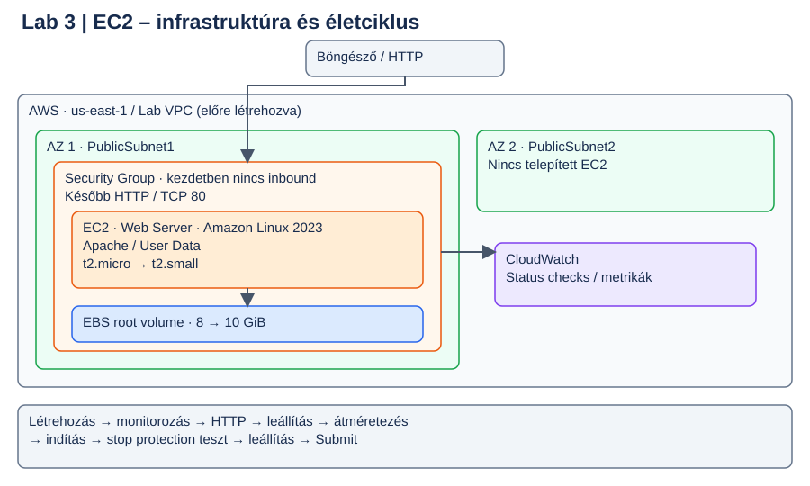
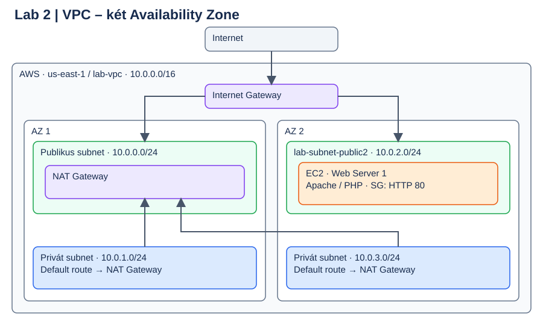

::: {.callout-important}
## Munkakörnyezet és beadás
**Órai idő: 90 perc** (regisztráció előzetesen). Kövesd az AWS Academy hivatalos laborutasításait, az erőforrásneveket pontosan tartsd be. A munkafüzetbe saját eredményeidet másold, képernyőkép nem szükséges. A válaszok helyben automatikusan mentődnek. **Jelszót, access key-t, secret key-t, session tokent vagy privát kulcsot ne adj be!** Beadási határidő: **2026. december 3., 11:40 (magyar idő).**
:::

**Neptun-kód (kötelező, 6 karakter):** <input id="neptun" data-answer="STUDENT_ID" maxlength="6" pattern="[A-Za-z0-9]{6}" required placeholder="ABC123" />

## A gyakorlat célja

Az AWS infrastruktúra megismerése két irányított labor és parancssori lekérdezések segítségével. Az Azure-ban megismert fogalmak AWS-megfelelői tájékozódási segítségként:

| Azure | AWS |
|---|---|
| Virtual Machine | EC2 instance |
| Virtual Network | VPC |
| Subnet | Subnet |
| Network Security Group | Security Group (közelítő megfelelő) |
| Managed Disk | EBS volume |
| Blob Storage | S3 |
| Azure Monitor | CloudWatch |
| Azure RBAC / Entra ID | IAM (részleges funkcionális megfelelés) |

## I. AWS Academy – előzetes regisztráció

### 1. Meghívó elfogadása

**Platform:** AWS Academy / email.

Nyisd meg az egyetemi email-címre érkezett meghívót, fogadd el és fejezd be a regisztrációt.

::: {.callout-note collapse="true"}
## Segítség és hibakeresés
Ellenőrizd a levélszemét mappát; hiányzó meghívó esetén jelezd az oktatónak.
:::

<div class="lab-answer"><label for="q01result"><strong>Dokumentálandó adatok – A felületen látható saját megjelenített név és a regisztráció eredménye.</strong></label><textarea id="q01result" data-answer="Q01_RESULT" rows="6" placeholder="Másold be vagy írd be ide a kért adatokat!"></textarea><button type="button" class="btn btn-outline-primary btn-sm lab-check" data-check="task">Formai ellenőrzés</button><span class="lab-feedback" role="status" aria-live="polite"></span></div>

### 2. Kurzus megnyitása

**Platform:** AWS Academy.

Jelentkezz be, nyisd meg a Cloud Foundations kurzust, keresd meg a Lab 3 és Lab 2 feladatokat.

<div class="lab-answer"><label for="q02result"><strong>Dokumentálandó adatok – A kurzus pontos neve és a két labor megjelenő címe.</strong></label><textarea id="q02result" data-answer="Q02_RESULT" rows="6" placeholder="Másold be vagy írd be ide a kért adatokat!"></textarea><button type="button" class="btn btn-outline-primary btn-sm lab-check" data-check="task">Formai ellenőrzés</button><span class="lab-feedback" role="status" aria-live="polite"></span></div>

## II. Lab 3 – Introduction to Amazon EC2 (30 perc)

{width="100%"}

Indítsd el a Lab 3 környezetet (Start Lab), várd meg a zöld jelzést, majd nyisd meg az AWS konzolt. Régió: N. Virginia (us-east-1). A hivatalos labor becslése 35 perc.

### 3. EC2 létrehozása

**Platform:** EC2 Console.

Végezd el a Task 1 lépéseit: Web Server, Amazon Linux 2023, t2.micro, vockey, Lab VPC, PublicSubnet1, új Web Server security group bejövő szabály nélkül, 8 GiB EBS, termination protection és a labor User Data szkriptje. Várd meg a futó állapotot.

::: {.callout-note collapse="true"}
## Segítség és hibakeresés
Explicit deny esetén ellenőrizd a régiót, a Lab VPC-t és a PublicSubnet1 kiválasztását, valamint az előírt instance type-ot. Ne próbáld megkerülni a jogosultsági korlátozást; másold a hibát és jelezd az oktatónak.
:::

<div class="lab-answer"><label for="q03result"><strong>Dokumentálandó adatok – Instance ID, AMI, instance type, VPC/subnet, publikus IPv4, termination protection és státusz.</strong></label><textarea id="q03result" data-answer="Q03_RESULT" rows="6" placeholder="Másold be vagy írd be ide a kért adatokat!"></textarea><button type="button" class="btn btn-outline-primary btn-sm lab-check" data-check="task">Formai ellenőrzés</button><span class="lab-feedback" role="status" aria-live="polite"></span></div>

### 4. Monitorozás

**Platform:** EC2 / CloudWatch.

Task 2: nyisd meg a Status checks és Monitoring lapokat, majd a Get system log és Get instance screenshot funkciókat.

::: {.callout-note collapse="true"}
## Segítség és hibakeresés
Ha a log vagy metrika még nem érhető el, várj röviden, majd frissíts; dokumentáld a tényleges állapotot.
:::

<div class="lab-answer"><label for="q04result"><strong>Dokumentálandó adatok – Status checks eredménye, egy látható metrika neve és értéke (ha van), a system log releváns részlete.</strong></label><textarea id="q04result" data-answer="Q04_RESULT" rows="6" placeholder="Másold be vagy írd be ide a kért adatokat!"></textarea><button type="button" class="btn btn-outline-primary btn-sm lab-check" data-check="task">Formai ellenőrzés</button><span class="lab-feedback" role="status" aria-live="polite"></span></div>

### 5. HTTP-hozzáférés

**Platform:** EC2 / böngésző.

Task 3: próbáld elérni a publikus IPv4 címet HTTP-n, majd add hozzá az előírt HTTP / Anywhere-IPv4 szabályt a security grouphoz, és ismételd meg a tesztet.

::: {.callout-note collapse="true"}
## Segítség és hibakeresés
Használj http:// előtagot. A nyitott HTTP-szabály csak az ideiglenes laborhoz szükséges.
:::

<div class="lab-answer"><label for="q05result"><strong>Dokumentálandó adatok – Első teszt eredménye, security group ID, új inbound szabály és a weboldalon ténylegesen megjelenő szöveg.</strong></label><textarea id="q05result" data-answer="Q05_RESULT" rows="6" placeholder="Másold be vagy írd be ide a kért adatokat!"></textarea><button type="button" class="btn btn-outline-primary btn-sm lab-check" data-check="task">Formai ellenőrzés</button><span class="lab-feedback" role="status" aria-live="polite"></span></div>

### 6. Átméretezés és védelem

**Platform:** EC2 / Service Quotas.

Task 4–6: állítsd le a gépet, módosítsd t2.small típusra, engedélyezd a stop protectiont, növeld az EBS méretét 10 GiB-ra, indítsd el. Nézd meg az EC2 kvótákat. Próbáld leállítani, majd kapcsold ki a stop protectiont és állítsd le.

<div class="lab-answer"><label for="q06result"><strong>Dokumentálandó adatok – Új instance type, volume ID és méret, egy megjelenő kvóta neve és értéke, a védett leállítás hibaüzenete, végső állapot.</strong></label><textarea id="q06result" data-answer="Q06_RESULT" rows="6" placeholder="Másold be vagy írd be ide a kért adatokat!"></textarea><button type="button" class="btn btn-outline-primary btn-sm lab-check" data-check="task">Formai ellenőrzés</button><span class="lab-feedback" role="status" aria-live="polite"></span></div>

### 7. Lab 3 beadása

**Platform:** Vocareum.

Submit → Yes → Grades → Submission Report. Másold ki az eredményeket, majd End Lab.

::: {.callout-note collapse="true"}
## Segítség és hibakeresés
Egyes ellenőrzésekhez öt perc várakozás szükséges. Ha indokolt, ismételd meg a Submit műveletet; az utolsó beadás számít.
:::

<div class="lab-answer"><label for="q07result"><strong>Dokumentálandó adatok – Elért/maximális pontszám és a Submission Report feladatonkénti eredménye.</strong></label><textarea id="q07result" data-answer="Q07_RESULT" rows="6" placeholder="Másold be vagy írd be ide a kért adatokat!"></textarea><button type="button" class="btn btn-outline-primary btn-sm lab-check" data-check="task">Formai ellenőrzés</button><span class="lab-feedback" role="status" aria-live="polite"></span></div>

## III. Lab 2 – Build your VPC and Launch a Web Server (45 perc)

{width="100%"}

Indítsd el a külön Lab 2 környezetet. A két labor erőforrásai nem feltétlenül azonos munkamenetben érhetők el.

### 8. VPC és átjárók

**Platform:** VPC Console.

Task 1: hozd létre a lab-vpc hálózatot a hivatalos VPC and more beállításokkal (10.0.0.0/16, egy AZ, egy publikus és egy privát subnet, NAT gateway egy AZ-ban).

::: {.callout-note collapse="true"}
## Segítség és hibakeresés
Várd meg a létrehozási folyamat végét, különösen a NAT gateway rendelkezésre állását.
:::

<div class="lab-answer"><label for="q08result"><strong>Dokumentálandó adatok – VPC ID, név, CIDR, Internet Gateway ID, NAT Gateway ID és állapot.</strong></label><textarea id="q08result" data-answer="Q08_RESULT" rows="6" placeholder="Másold be vagy írd be ide a kért adatokat!"></textarea><button type="button" class="btn btn-outline-primary btn-sm lab-check" data-check="task">Formai ellenőrzés</button><span class="lab-feedback" role="status" aria-live="polite"></span></div>

### 9. További subnetek

**Platform:** VPC Console.

Task 2: hozd létre a második AZ publikus és privát subnetjét az előírt nevekkel és CIDR-ekkel.

<div class="lab-answer"><label for="q09result"><strong>Dokumentálandó adatok – Mind a négy subnet neve, ID-ja, CIDR-je és Availability Zone-ja.</strong></label><textarea id="q09result" data-answer="Q09_RESULT" rows="6" placeholder="Másold be vagy írd be ide a kért adatokat!"></textarea><button type="button" class="btn btn-outline-primary btn-sm lab-check" data-check="task">Formai ellenőrzés</button><span class="lab-feedback" role="status" aria-live="polite"></span></div>

### 10. Útválasztás

**Platform:** VPC Console.

Task 2: rendeld a második privát subnetet a privát route table-höz, a második publikus subnetet a publikus route table-höz a labor szerint.

<div class="lab-answer"><label for="q10result"><strong>Dokumentálandó adatok – Mindkét route table ID-ja, útvonalai (destination/target) és a társított subnetek.</strong></label><textarea id="q10result" data-answer="Q10_RESULT" rows="6" placeholder="Másold be vagy írd be ide a kért adatokat!"></textarea><button type="button" class="btn btn-outline-primary btn-sm lab-check" data-check="task">Formai ellenőrzés</button><span class="lab-feedback" role="status" aria-live="polite"></span></div>

### 11. Web Security Group

**Platform:** VPC Console.

Task 3: hozd létre a Web Security Groupot a lab-vpc hálózatban, a laborban előírt HTTP inbound szabállyal.

<div class="lab-answer"><label for="q11result"><strong>Dokumentálandó adatok – Security group ID, VPC ID, inbound szabály típusa, portja és forrása.</strong></label><textarea id="q11result" data-answer="Q11_RESULT" rows="6" placeholder="Másold be vagy írd be ide a kért adatokat!"></textarea><button type="button" class="btn btn-outline-primary btn-sm lab-check" data-check="task">Formai ellenőrzés</button><span class="lab-feedback" role="status" aria-live="polite"></span></div>

### 12. Web Server 1

**Platform:** EC2 / böngésző.

Task 4: indítsd el a Web Server 1 instance-t Amazon Linux 2023, t2.micro, vockey, lab-subnet-public2, publikus IP engedélyezése, meglévő Web Security Group és a hivatalos User Data szkript használatával. Teszteld a publikus DNS címet HTTP-n.

::: {.callout-note collapse="true"}
## Segítség és hibakeresés
Ha nem tölt be az oldal, ellenőrizd a publikus subnetet, route table-t, HTTP-szabályt és várd meg a User Data futását.
:::

<div class="lab-answer"><label for="q12result"><strong>Dokumentálandó adatok – Instance ID, publikus DNS, státuszellenőrzés és a weboldalon megjelenő instance-metaadatok.</strong></label><textarea id="q12result" data-answer="Q12_RESULT" rows="6" placeholder="Másold be vagy írd be ide a kért adatokat!"></textarea><button type="button" class="btn btn-outline-primary btn-sm lab-check" data-check="task">Formai ellenőrzés</button><span class="lab-feedback" role="status" aria-live="polite"></span></div>

### 13. Lab 2 beadása

**Platform:** Vocareum.

Submit → Yes → Grades → Submission Report. Rögzítsd az eredményt. A riport rögzítése után zárd le a labort (End Lab). A következő feladatok külön Sandbox környezetben futnak.

<div class="lab-answer"><label for="q13result"><strong>Dokumentálandó adatok – Elért/maximális pontszám és a Submission Report feladatonkénti eredménye.</strong></label><textarea id="q13result" data-answer="Q13_RESULT" rows="6" placeholder="Másold be vagy írd be ide a kért adatokat!"></textarea><button type="button" class="btn btn-outline-primary btn-sm lab-check" data-check="task">Formai ellenőrzés</button><span class="lab-feedback" role="status" aria-live="polite"></span></div>

## IV. AWS CLI – irányított lekérdezések (15 perc)

### 14. Sandbox indítása és AWS CloudShell megnyitása

**Platform:** AWS Academy / Sandbox / AWS Management Console.

1. Az AWS Academy kurzusban nyisd meg a **Modules → Sandbox environment** elemet.
2. Kattints a **Start Lab** gombra. Az indítás akár 4–5 percig is eltarthat.
3. Várd meg, amíg az AWS állapotjelző zöldre vált, majd kattints az **AWS** ikonra az AWS Management Console megnyitásához.
4. A konzol felső menüsorában kattints a **CloudShell** ikonra (`>_`). Várd meg a parancssor megjelenését.

::: {.callout-note collapse="true"}
## Segítség és hibakeresés
Ne a Vocareum beépített Terminal ablakát használd, hanem az AWS Management Console CloudShell környezetét. A CloudShell automatikusan átveszi az aktuális munkamenet hitelesítését, ezért nincs szükség az `aws configure` parancsra vagy hozzáférési kulcsokra. Ha nem indul el, ellenőrizd a labor állapotát és jelezd az oktatónak.
:::

<div class="lab-answer"><label for="q14result"><strong>Dokumentálandó adatok – A CloudShell megnyitásának eredménye és a megjelenő régió.</strong></label><textarea id="q14result" data-answer="Q14_RESULT" rows="6" placeholder="CloudShell állapota és régiója..."></textarea><button type="button" class="btn btn-outline-primary btn-sm lab-check" data-check="task">Formai ellenőrzés</button><span class="lab-feedback" role="status" aria-live="polite"></span></div>

### 15. AWS-erőforrások lekérdezése

**Platform:** AWS CloudShell / Bash.

Futtasd egymás után a következő három lekérdező parancsot. Másold be a parancsokat és a tényleges kimenetüket az alábbi mezőbe.

**EC2 instance-ok:**

```bash
aws ec2 describe-instances --region us-east-1 \
  --query 'Reservations[].Instances[].{ID:InstanceId,Type:InstanceType,State:State.Name,PrivateIP:PrivateIpAddress}' \
  --output table
```

**Virtuális hálózatok (VPC):**

```bash
aws ec2 describe-vpcs --region us-east-1 \
  --query 'Vpcs[].{ID:VpcId,CIDR:CidrBlock}' --output table
```

**S3 bucketek:**

```bash
aws s3 ls
```

::: {.callout-note collapse="true"}
## Segítség és hibakeresés
A parancsok másolhatók a munkafüzetből. Ha a kimenet üres, ezt is dokumentáld; ne hozz létre új erőforrást. Ha jogosultsági hiba jelenik meg, másold be a hibaüzenetet és jelezd az oktatónak. Ha lapozó nyílik meg, a `q` billentyűvel léphetsz ki.
:::

<div class="lab-answer"><label for="q15result"><strong>Kiadott parancsok és azok kimenete – Mindhárom parancs és tényleges kimenete.</strong></label><textarea id="q15result" data-answer="Q15_RESULT" rows="6" placeholder="Másold be a három parancsot és kimenetüket!"></textarea><button type="button" class="btn btn-outline-primary btn-sm lab-check" data-check="task">Formai ellenőrzés</button><span class="lab-feedback" role="status" aria-live="polite"></span></div>

A kimenetek rögzítése után zárd le a Sandbox labort (**End Lab**).

**Beadás:** ellenőrizd a 15 mezőt, majd használd a Beadás gombot. Tartalék: JSON export.

```{=html}
<style>
.lab-answer {display:flex;flex-direction:column;gap:.45rem;margin:1rem 0 1.5rem}
.lab-answer input,.lab-answer textarea {width:100%;max-width:100%;padding:.65rem;border:1px solid #9ca3af;border-radius:5px;font:inherit}
.lab-answer textarea {min-height:6rem;resize:vertical}
.lab-answer button {align-self:flex-start}
.lab-feedback.ok {color:#176b36}.lab-feedback.warn {color:#a45c00}
</style>
```

## Mentés és beadás

A válaszok automatikusan mentődnek ebben a böngészőben. A szerveres beadást az oktató a közzététel előtt ellenőrzi a 10. heti feladatokhoz. A beadás előtt ellenőrizd a Neptun-kódot és a kitöltött mezőket. A formai ellenőrzés nem helyettesíti a parancsok tényleges futtatását.

<div class="actions">
<button id="submit-button" type="button" onclick="openSubmissionSummary()">📤 Beadás</button>
<button type="button" onclick="exportSubmissionJson()">💾 JSON export</button>
<button type="button" onclick="clearAnswers()">Helyi adatok törlése</button>
<span id="save-status" role="status"></span>
</div>
<p id="submission-deadline-note"><strong>Beadási határidő:</strong> 2026. december 3., 11:40 (magyar idő).</p>
<div id="submission-summary" class="submission-summary" hidden>
<h3>Beadás előtti összesítés</h3>
<div id="submission-summary-body"></div>
<div class="actions"><button type="button" onclick="closeSubmissionSummary()">Vissza a javításhoz</button><button id="confirm-submit-button" type="button" onclick="confirmSubmission()">Beadás megerősítése</button></div>
</div>
<div id="submission-result" role="status" aria-live="polite"></div>

::: {.callout-note title="Aktivitási adatok"}
Az időmérés és az eseménykövetés a projekt `config/setup.js` fájljából konfigurálható. Az SSH-terminálban végzett munka nem feltétlenül számít böngészőbeli aktív időnek.
:::
<div id="tracking-panel" class="submission-summary">
<strong>Aktivitás ezen a gépen</strong>
<p>Időmérés: <span id="tracking-time-status">–</span> · Eseménykövetés: <span id="tracking-event-status">–</span></p>
<p>Becsült aktív idő: <span id="activity-active-time">0:00</span> · Szerkesztések: <span id="activity-edit-count">0</span></p>
<p>Első megnyitás: <span id="activity-started">–</span> · Utolsó aktivitás: <span id="activity-last">–</span></p>
</div>

<style>
.actions {display:flex;flex-wrap:wrap;gap:.65rem;align-items:center;margin:1rem 0}
.actions button {padding:.55rem .9rem;border:1px solid #77808a;border-radius:6px;background:#fff;cursor:pointer}
.actions button:disabled {opacity:.5;cursor:not-allowed}
.submission-summary {border:1px solid #c8d0d8;border-radius:9px;padding:1rem;margin:1rem 0;background:#fafbfc}
.submission-summary[hidden] {display:none}
#submission-result {margin:1rem 0}
</style>
<script src="../../config/setup.js"></script>
<script>
(function(){
  const patterns={
    task:/[\s\S]{12,}/,
    ssh:/\b(ssh|whoami|hostname|pwd)\b/i, csv:/[;]|\b(cut|awk|grep|tail)\b/i,
    bash:/\b(while|for|read|mkdir|cp|bash|chmod|jed)\b/i,
    diff:/\bdiff\b|---|\+\+\+/i,
    git:/\bgit\s+(init|status|add|commit|log|diff|branch|switch|merge|remote|push|fetch|pull|config)\b/i,
    github:/github\.com|gh auth|https/i,
    vscode:/Source Control|Remote.SSH|VS Code|stage|commit|sync/i
  };
  document.addEventListener('click',e=>{
    const b=e.target.closest('.lab-check'); if(!b)return;
    const wrap=b.closest('.lab-answer'), field=wrap?.querySelector('input,textarea');
    const feedback=wrap?.querySelector('.lab-feedback'); if(!field||!feedback)return;
    const v=field.value.trim(),type=b.dataset.check,p=patterns[type]||/\S{12}/;
    const ok=type==='sha'?/^[0-9a-fA-F]{7,12}$/.test(v):type==='repo-url'?/^https:\/\/github\.com\/[A-Za-z0-9-]+\/[A-Za-z0-9._-]+\/?$/.test(v):v.length>=8&&p.test(v);
    feedback.textContent=ok?'A válasz formátuma megfelelőnek tűnik. A tényleges végrehajtást ez nem igazolja.':(type==='sha'?'Adj meg 7–12 hexadecimális karaktert.':type==='repo-url'?'Adj meg teljes GitHub-repository URL-t.':'Egészítsd ki a feladatban kért parancsokkal és kimenetekkel.');
    feedback.className='lab-feedback '+(ok?'ok':'warn');
  });
})();
</script>
```

<script>
(() => {
  'use strict';
  const CONFIG = Object.assign({timeTracking:false,eventTracking:false,showTrackingPanel:false},window.ITARCH_SETUP||{});
  const STORAGE_KEY = 'itarch_week10_answers_2026';
  const STARTERS = {};

  // Beadási határidő: 2026. december 3. 11:40, Europe/Budapest (CET, UTC+01:00).
  const SUBMISSION_DEADLINE_ISO = '2026-12-03T11:40:00+01:00';
  const ENDPOINT = 'https://itarch-backend-fpdsf6brfpanf5d8.northeurope-01.azurewebsites.net/api/submit';
  const $ = id => document.getElementById(id);
  const fields = () => [...document.querySelectorAll('[data-answer]')];
  const studentId = () => ($('neptun')?.value||'').trim().toUpperCase();
  const validId = () => /^[A-Z0-9]{6}$/.test(studentId());
  const nowIso = () => new Date().toISOString();
  const deadline = SUBMISSION_DEADLINE_ISO ? new Date(SUBMISSION_DEADLINE_ISO) : null;
  const closed = () => deadline && !isNaN(deadline.getTime()) && Date.now() > deadline.getTime();
  const started = nowIso();
  let activity = {started_at:started,last_activity_at:started,active_seconds_estimate:0,edit_count:0,events:[]};
  let lastInteraction = Date.now();
  const esc = v => String(v??'').replace(/[&<>"']/g,c=>({'&':'&amp;','<':'&lt;','>':'&gt;','"':'&quot;',"'":'&#39;'}[c]));
  const logEvent = (type) => {if(CONFIG.eventTracking) activity.events.push({type,at:nowIso()});};
  const answers = () => Object.fromEntries(fields().filter(f=>f.dataset.answer!=='STUDENT_ID').map(f=>[f.dataset.answer,f.value]));
  const save = (message=false) => {
    activity.last_activity_at=nowIso();
    try {localStorage.setItem(STORAGE_KEY,JSON.stringify({student_id:studentId(),answers:answers(),activity}));
      if(message) $('save-status').textContent='✓ Helyi mentés kész';
    } catch(e) {if(message) $('save-status').textContent='⚠ Helyi mentés nem érhető el';}
  };
  const load = () => {
    try {const stored=JSON.parse(localStorage.getItem(STORAGE_KEY)||'null'); if(!stored)return;
      if(stored.student_id) $('neptun').value=stored.student_id;
      fields().forEach(f=>{if(f.dataset.answer!=='STUDENT_ID' && Object.hasOwn(stored.answers||{},f.dataset.answer) && String(stored.answers[f.dataset.answer]??'').trim())f.value=stored.answers[f.dataset.answer]});
      if(stored.activity)activity=Object.assign(activity,stored.activity);
    }catch(e){}
  };
  const renderActivity = () => {
    $('tracking-panel').hidden=!CONFIG.showTrackingPanel;
    $('tracking-time-status').textContent=CONFIG.timeTracking?'bekapcsolva':'kikapcsolva';
    $('tracking-event-status').textContent=CONFIG.eventTracking?'bekapcsolva':'kikapcsolva';
    const sec=activity.active_seconds_estimate||0;
    $('activity-active-time').textContent=`${Math.floor(sec/60)}:${String(sec%60).padStart(2,'0')}`;
    $('activity-edit-count').textContent=activity.edit_count||0;
    $('activity-started').textContent=activity.started_at||'–';
    $('activity-last').textContent=activity.last_activity_at||'–';
  };
  const refreshDeadline = () => {
    const isClosed=closed();
    $('submit-button').hidden=!!isClosed;
    if($('confirm-submit-button'))$('confirm-submit-button').disabled=!!isClosed||!validId();
    $('submission-deadline-note').textContent=deadline && !isNaN(deadline.getTime())
      ? `Beadási határidő: ${deadline.toLocaleString('hu-HU',{timeZone:'Europe/Budapest'})} (magyar idő)${isClosed?' – lejárt':''}`
      : 'Beadási határidő: még nincs beállítva a munkafüzetben.';
  };
  const payload = () => ({schema_version:1,course:'ITARCH',week:10,student_id:studentId(),submitted_at:nowIso(),answers:answers(),checks:{},activity_summary:activity});
  window.openSubmissionSummary = () => {
    refreshDeadline();if(closed())return;
    const fs=fields().filter(f=>f.dataset.answer!=='STUDENT_ID');
    const missing=fs.filter(f=>!f.value.trim() || (Object.hasOwn(STARTERS,f.dataset.answer) && f.value.trim()===STARTERS[f.dataset.answer].trim()));
    const groups=[...new Set(missing.map(f=>(f.dataset.answer.match(/^Q(\d\d)/)||[])[1]).filter(Boolean))];
    const complete=fs.length-missing.length;
    $('submission-summary-body').innerHTML=`<p><strong>Neptun:</strong> ${esc(studentId()||'nincs megadva')} ${validId()?'✓':'⚠ 6 betű/szám szükséges'}</p>
      <p><strong>Kitöltött mezők:</strong> ${complete}/${fs.length} (${Math.round(100*complete/Math.max(1,fs.length))}%)</p>
      <p><strong>Hiányos feladatok:</strong> ${groups.length?groups.map(x=>Number(x)).join(', '):'nincs'}</p>
      ${missing.length?`<p>Összesen ${missing.length} mező üres. A beadás ettől még lehetséges, de ellenőrizd a válaszokat.</p>`:''}
      <p>A szintaktikai ellenőrző gombok használata nem kötelező. Biztosan beadod?</p>`;
    $('submission-summary').hidden=false;
    $('submission-summary').scrollIntoView({behavior:'smooth',block:'start'});
    logEvent('submission_summary_opened');save();refreshDeadline();
  };
  window.closeSubmissionSummary=()=>{$('submission-summary').hidden=true;};
  const download = data => {
    const file=`ITARCH_week10_${data.student_id}_${data.submitted_at.replace(/[:.]/g,'-')}.json`;
    const blob=new Blob([JSON.stringify(data,null,2)],{type:'application/json;charset=utf-8'});
    const url=URL.createObjectURL(blob),a=document.createElement('a');a.href=url;a.download=file;document.body.append(a);a.click();a.remove();setTimeout(()=>URL.revokeObjectURL(url),1000);
  };
  window.exportSubmissionJson=()=>{if(!validId()){$('submission-result').textContent='⚠ A JSON exporthoz 6 karakteres Neptun-kód szükséges.';return;}logEvent('submission_json_exported');save();download(payload());};
  window.confirmSubmission=async()=>{
    if(closed()){$('submission-result').textContent='⚠ A beadási határidő lejárt.';refreshDeadline();return;}
    if(!validId()){$('submission-result').textContent='⚠ Adj meg érvényes, 6 karakteres Neptun-kódot.';return;}
    const btn=$('confirm-submit-button');btn.disabled=true;
    $('submission-result').textContent='Beadás folyamatban…';
    try {
      const response=await fetch(ENDPOINT,{method:'POST',headers:{'Content-Type':'application/json'},body:JSON.stringify(payload())});
      const result=await response.json().catch(()=>null);
      if(!response.ok||!result||result.success!==true)throw new Error(`HTTP ${response.status}`);
      logEvent('submission_succeeded');save();$('submission-summary').hidden=true;
      $('submission-result').textContent=`✓ Beadás sikeres. Azonosító: ${result.submission_id||'–'}`;
    }catch(e){logEvent('submission_failed');save();$('submission-result').textContent='⚠ A szerveres beadás nem sikerült. A helyi mentés megmaradt; próbáld újra, vagy készíts JSON exportot.';}
    finally {btn.disabled=false;refreshDeadline();}
  };
  window.clearAnswers=()=>{
    if(!confirm('Biztosan törlöd az összes helyben mentett választ és aktivitási adatot?'))return;
    fields().forEach(f=>f.value=f.dataset.answer==='STUDENT_ID'?'':(STARTERS[f.dataset.answer]||f.defaultValue||''));
    try{localStorage.removeItem(STORAGE_KEY)}catch(e){}
    activity={started_at:nowIso(),last_activity_at:nowIso(),active_seconds_estimate:0,edit_count:0,events:[]};
    $('submission-summary').hidden=true;$('submission-result').textContent='';$('save-status').textContent='Helyi adatok törölve.';renderActivity();
  };
  document.addEventListener('DOMContentLoaded',()=>{
    fields().forEach(f=>{if(Object.hasOwn(STARTERS,f.dataset.answer))f.value=STARTERS[f.dataset.answer];});
    load();refreshDeadline();renderActivity();
    fields().forEach(f=>{f.addEventListener('input',()=>{
      if(f.dataset.answer==='STUDENT_ID')f.value=f.value.toUpperCase().replace(/[^A-Z0-9]/g,'').slice(0,6);
      activity.edit_count++;lastInteraction=Date.now();logEvent('answer_edited');save();renderActivity();
    });f.addEventListener('change',()=>save());});
    document.addEventListener('keydown',()=>lastInteraction=Date.now());
    document.addEventListener('mousemove',()=>lastInteraction=Date.now(),{passive:true});
    document.addEventListener('visibilitychange',()=>save());
    window.addEventListener('beforeunload',()=>save());
    setInterval(()=>{if(CONFIG.timeTracking&&!document.hidden&&Date.now()-lastInteraction<120000){activity.active_seconds_estimate++;if(activity.active_seconds_estimate%10===0)save();renderActivity();}},1000);
    setInterval(refreshDeadline,30000);
  });
})();
</script>
